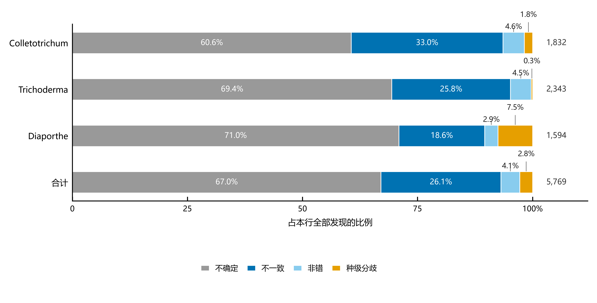
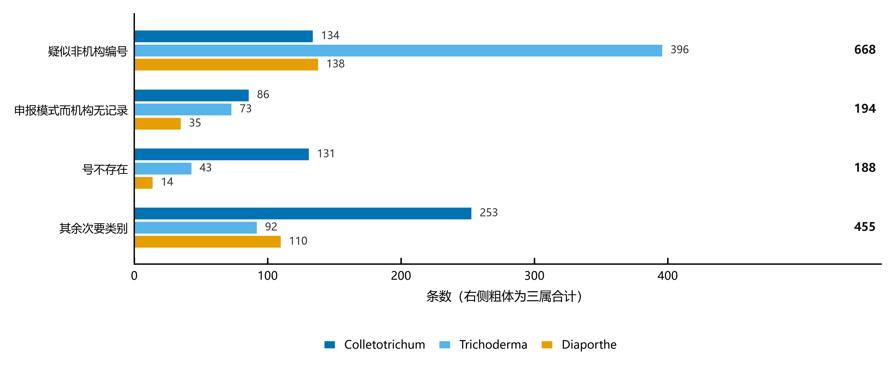

# 属级元数据审计：三个真菌属的保藏号、模式地位与名称一致性

**A genus-level metadata audit of three fungal genera: culture numbers, type status and name consistency**

〔作者姓名〕1*

1. 〔单位、城市、国家〕
   \* 〔通讯邮箱〕

> **文献信息**
>
> 引用格式：〔作者〕(2026) 属级元数据审计：三个真菌属的保藏号、模式地位与名称一致性。〔期刊〕〔卷〕: 〔页码〕。
> 预印本 DOI：10.5281/zenodo.23574863（概念 DOI，始终指向最新版）
> 数据与代码：https://github.com/xiangccookie/typeaudit
> 收稿 〔日期〕 · 接收 〔日期〕 · 发表 〔日期〕

**关于本文**　本文的全部计数来自一次可复现的流水线，数据快照固定为 2026 年 10 月 10 日；凡引用本文数字，请连同该日期一并给出。文中反复出现的三个量——全部号、可核号、号级不一致——各自的分母不同，第 2 节逐一交代。表 1–3 为数据表，图 1–5 为结果图，术语与名词解释见补充材料，按主题分组，逐条给出英文原词、通俗解释以及它在本文语境中的具体含义。

---

## 摘要

公共数据库里的菌株保藏号、模式地位与名称，是分类学、植物病理与流行病学研究的共同基础。同一批菌株在 GenBank（由作者申报）、NCBI Taxonomy（由策展人核实）、MycoBank（跟进文献做名称合并）与各保藏中心的实体目录之间，可能给出彼此矛盾的记录，而这些矛盾长期缺乏系统性检验。本文不讨论理想中的标识符体系，而是问一个更朴素的问题：在当下已经存在的记录里，我们究竟能把「这一株菌叫什么、是不是模式、属于哪个种」核对到什么程度。我们以 Colletotrichum、Trichoderma、Diaporthe 三个真菌属为对象（合计 1,360 个规范双名、11,103 条「号 × 种」记录），把 GenBank 记录名、NCBI 分类名、MycoBank 接受名与 CBS、ICMP、CGMCC 三家保藏中心的公开目录四方交叉比对，并对全部种级分歧逐条查文献裁决。结果显示：只有 27.4% 的号能在机构目录中核对，而这一比例在属间相差约两倍，原因不在记录质量而在机构覆盖；以可核号为分母，号级不一致率为 13.3%（95% 置信区间 12.1–14.5%），且这一数字偏严、应视为上限；1,505 条不一致中，真正的多数（668 条，44.4%）是「号根本不是机构号」，前三类合计 1,050 条（69.8%）都指向「号」本身，其余 455 条才涉及名称与模式地位；160 条种级分歧中 114 条支持 MycoBank、8 条提示其过度合并，且方向由单一属主导、不能外推。这些结果表明：用学名把菌株、序列与记录连接起来，本身并不可靠；而判断它在何处不可靠，必须先解决「有没有得比」——可核查率不是数据的附属信息，而是结论的一部分。更进一步，在 183 个已有参考基因组的种中，67.2% 的基因组全部来自非模式菌株，9 个组装被 NCBI 官方判为分类学归属错误——**元数据的不一致已经传导到最常被调用的对象上**。

**关键词**　元数据审计；保藏号；模式材料；同名异物；有性型属名；NCBI Taxonomy；MycoBank

## Abstract

Culture collection numbers, type status and names underpin taxonomic, plant-pathological and epidemiological research, yet the records carrying them are maintained by different parties with different practices: GenBank records are author-submitted, NCBI Taxonomy is curator-verified, MycoBank follows the literature when merging names, and holding collections register material in their own catalogues. Rather than proposing an ideal identifier scheme, we ask how far the existing records can actually be verified. We audited all accepted binomials of three fungal genera (Colletotrichum, Trichoderma, Diaporthe; 1,360 names, 11,103 number-by-species records), cross-checking GenBank record names, NCBI taxonomic names, MycoBank accepted names and the public catalogues of three collections (CBS, ICMP, CGMCC), and adjudicated every species-level conflict against the primary literature. Only 27.4% of numbers could be verified, and this fraction differed about two-fold among genera because of collection coverage rather than record quality. Among verifiable numbers the discrepancy rate was 13.3% (95% CI 12.1–14.5%), an upper bound. Of the 1,505 discrepancies, the largest class (668, 44.4%) involved numbers that are not institutional accessions at all; only the remaining 455 involve names or type status. Of 160 species-level conflicts, 114 favoured MycoBank and 8 suggested over-merging, but the direction was dominated by a single genus. Linking strains, sequences and records by name is therefore intrinsically unreliable, and deciding where it fails requires first establishing what can be checked: verifiability is part of the conclusion, not ancillary. Downstream, of the 183 species with reference genomes, 67.2% are represented entirely by non-type strains, and 9 assemblies carry NCBI's own flag that their taxonomic assignment is incorrect.

**Keywords**　metadata audit; culture collection numbers; type material; homonyms; teleomorph genus names; NCBI Taxonomy; MycoBank

## 数据、代码与资助

**数据与代码可用性**　支撑本文结论的全部数据与代码公开于 GitHub（https://github.com/xiangccookie/typeaudit，MIT 许可），并以 Zenodo 永久归档：概念 DOI 10.5281/zenodo.23574863（始终指向最新版）；本文对应 v1.3.1，与 v1.3.0（10.5281/zenodo.23624184）内容相同，仅修正了版本号引用。仓库包含审计流程源码、三属全部结果表（三列表、覆盖声明、发现汇总、四方核验、序列轴、分类库、反向审计、分歧裁决表、30 条验证子样本、类型号反查、基因组层、受信菌株表）、已知错误的回归测试集（32 例）与三个属的规范物种清单。为便于不具备编程基础的读者核对，仓库另附 Windows 启动器：解压后双击即可在浏览器中载入任一属的结果，无需联网、无需安装 Python、无需重跑流水线。复现三属结果的主命令为 `python tools/chain_genus.py --genus <属名> --chunk 40`。

**版本对应**　本文全部数字对应 **v1.3.1**（与 v1.3.0 内容相同，仅修正版本号引用）。较早的 v1.2.0（10.5281/zenodo.23595583）与 v1.0.9（10.5281/zenodo.23575367）口径不同：v1.2.0 的可核号为 3,192、发现 5,781，v1.0.9 则是剔除 41 条名字变体前的口径，**三者不可直接相减**；差异来源（分母收紧、变体改归、新增 H 与 T 两级）见仓库 `CHANGELOG.md`。

**资助与利益冲突**　〔待填〕

## 引言

关于生物多样性数据资源，有一个颇具吸引力的愿景：一片由相互连接的数字对象构成的云，每个对象带有一个可解析的全局唯一标识符，人与机器只需顺着这个标识符，就能从一件实物标本走到它的序列、图像与文献。在这个愿景里，菌株保藏号就是那个把「标本—序列—名称」三者串起来的铆钉：拿到一条序列记录，顺着它的保藏号去要菌株，再顺着菌株名去查这个种现在叫什么——这是分类学、植物病理诊断与多样性调查里每天都在做的动作。

然而这根铆钉并不结实。它一端钉在 GenBank 里，那里的记录由作者自己申报，未经独立核对；另一端钉在保藏中心的目录里，而目录的公开程度因机构而异，有的提供可机读检索，有的只在网页上列一张表，还有的根本不公开；中间还夹着两个分类库——NCBI Taxonomy 由策展人主动核实并维护模式地位与菌株—序列关联，MycoBank 则跟进文献做名称合并——它们对同一个名字是否该被并入另一个名字，常常给出相反答案。于是同一株菌可以在四个地方留下四种说法，而这四种说法之间的分歧，从来没有被系统地数过。

这并不是一个新问题，但以往的研究各自只覆盖了其中一段。一批工作从信息学角度诊断标识符本身的可靠性与管护实践，指出「三元组」（机构代码 + 馆藏代码 + 目录号）在实际部署中充斥着语义与句法错误；另一批工作从分类库一侧出发，讨论模式菌株与模式材料的记录质量，以及公共序列库中模式材料注释的缺失；还有一批工作专注两个名称库之间的合并分歧，检验某一次大规模修订是否站得住。三条线各自成熟，却缺一个把它们放在同一个分母下的属级量化：在一个属内，究竟有多少记录能核、核出来的不一致有多少、分歧偏向哪一方、以及按学名做跨库匹配会在哪里静默出错。

本文要回答的就是这三个问题，且顺序不能颠倒：**一、在属级尺度上，保藏号与名称记录之间号级不一致的频率是多少，分母应当怎么取（这决定了「错误率」这个数能不能被引用）？二、当两个维护型数据库给出相反答案时，谁更可能对（做分类的人与做病害诊断的人，该信哪一个）？三、按学名做跨库匹配，会在哪些地方静默出错（哪一步会把 A 种的序列悄悄接成 B 种）？** 第一问决定了后两问能不能被回答——如果多数记录根本无从核对，那么任何「错误率」都必须先交代它覆盖了哪一部分。

**三问合起来指向一个生物学问题**：一株被写进食谱、接种试验或检疫报告的菌，它的**名字、保藏号与序列是不是同一件事**？如果这三者在数据层就对不上，那么所有依赖它们的结论——这株菌属于哪个种、它是不是模式菌株、它的基因组能不能代表这个种——都失去锚点。**本文把三问的答案，最后都落到「谁在用、会怎么错」上。**

我们选择 Colletotrichum、Trichoderma、Diaporthe 三个属，依据有三：三者在 NCBI 分类库中有足够的种级记录（分别 2,277、2,574、1,600 个种级 taxon），过滤为规范双名后规模可比（408、445、507 种）；三者分属不同生态类群——植物病原（Colletotrichum）、生防与土壤真菌（Trichoderma）、内生与致病兼性（Diaporthe），使属间差异可被观察而不只是单属的偶然状况；其中 Diaporthe 近二十年大量拆种，且已被证明为并系属（paraphyletic，即该属并不包含其共同祖先的全部后代），理论上正是种级分歧最可能集中之处。这一点在后文得到验证，也成为我们不敢把结论外推的理由。

## 材料与方法

**数据从哪来。** 我们以 NCBI Taxonomy 的检索式为起点，取三个属内全部种级 taxon，再过滤为规范双名（两词、种加词小写；剔除 `sp.`、`cf.`、`aff.` 及仅到属名者），得到 Colletotrichum 408、Trichoderma 445、Diaporthe 507 种，合计 1,360 种。物种清单、命名人与模式材料取自 NCBI Taxonomy，序列与记录字段取自 NCBI Nucleotide，名字关系取自 MycoBank 本地导出（426,834 行），机构侧对照依据 CBS、ICMP、CGMCC 三家保藏中心的公开目录，分歧裁决依据 PubMed 与 PMC。全部查询完成于 2026 年 10 月 10 日，分类库与机构目录持续更新，本文的计数与结论仅对应这一天。

**我们是以什么作为分母的。** 我们统计的单位是「一个保藏号在一个种下的一次出现」，本文称为一个号级单元格：例如 CBS 126514 若同时出现在 *Diaporthe arecae* 与 *D. citri* 两个种下，就算 2 个号级单元格。这样定义是为了避免两种漏计——按号统计会漏掉「一株多名」，按种统计会忽略一个种下有多少条记录。分母只取可核号，即只有在三家保藏中心的公开机读目录里能核对到的号才进入分母；其余号的所在机构没有可机读目录、或只是研究者自己的工作编号，既不进分子也不进分母。这样取分母的理由很简单：若把核对不了的号算进分母，率会被稀释到没有意义；若把「查不了」当成「没问题」，又等于默认这一部分零错误。因此全文的「号级不一致率」一律是「号级不一致的单元格数 ÷ 可核号数」，且只描述可核号这一子集，不外推为三属整体。同理，可核率与不一致率都只按属报告、不排序：三个属的可核号来自不同机构，分母本就不同质，即便某一对差异在统计上显著，它反映的也可能是机构构成不同，而非记录质量更差。

**如何做判断，为什么这么判断。** 证据由强到弱分四档：原始发表（作者当年指定模式与编号，是真值）＞ 模式材料记录（二手转录，可能出错）＞ 保藏中心目录（实体登记方，公开程度不一）＞ GenBank 记录（作者申报，未经独立核对）。

核验分四层：号层（目录里有没有这个号，登记名与模式地位对不对）、名字层（NCBI 分类名、MycoBank 接受名、机构登记名、GenBank 记录名是否指向同一个种）、序列层（同一个号有没有被标成不同的种）、分类层（同一个号有没有被多个种登记为正模）。

四层的事实归入四类，判定只有三步：**能不能核**（机构无公开机读目录、或号检索不到 → 不确定；“查不到”不等于“没有”，故不判错）→ **差异是否正常**（能归入换属、词尾、拼写、种下单元、号已改派、名字未变之一 → 非错）→ **双方是否都作正面声明**（都写了“是这个种” → 不一致；只有一方“查无” → 仍记不确定）。第四类**种级分歧**不走这三步：它判的不是某条记录的对错，而是两库对“这个种该不该独立”的立场——NCBI 保留独立种、MycoBank 并入他名；这类没有第三方可裁，只能说“两库意见相反”，不能判谁对。

不一致内部还可再分：多数看形态即可判定，有三类必须回查原始发表——号不存在、登记名不符、模式地位不符（定义见上）。后文 30 条验证子样本即从这三类各取 10 条。

在此基础上，有七条具体规则，每一条都对应一种实测中反复出现的误判。其一，学名不同不等于异名：「学名与当前接受名不同」涵盖性质完全不同的四种关系，我们用种加词与词干的组合分辨他们，分别是换属（种加词相同，属名不同），拼写或性别更正（词干相同词尾不同），同名不同写法（标点或连字符差异），前三者是指向同一物种，而种加词不同才为异名。其二，证据有强弱，不能把作者申报当已核实,这条规则决定后文所有结论只能到‘冲突’，不能到‘谁对’。其三，同名异物要「机器列候选、人指认」：同一双名可被不同作者在不同年份各描述一次，MycoBank 如实登记多行，晚出者标 `Illegitimate`，而 NCBI 只对应其中一个 taxon；完整导出含 `Authors` 与 `Year of effective publication`，可据此自动列出候选，但 NCBI Taxonomy 对这些种未登记命名人，因此「哪一行对应这个 taxon」无法自动匹配，流程的处理是不选取任何一行、置空并标「待消歧」，同时输出候选行供人判断。其四，目录查无不等于号是假的：对判为「号不存在」者须回查 GenBank 是否有其他记录引用过它，检索式要写成 `CBS:126514`（冒号、不加引号），写成 `CBS 126514` 会被分词为 `CBS` AND `126514`，返回大量无关记录。其五，有性型属名要按词干比对：「一菌一名」改革后有性世代属名并入无性世代属名（如 *Hypocrea* → *Trichoderma*），`cerace-a` 与 `cerace-um` 是同一物种，仅因属名语法性别而词尾不同。其六，拼写变体看 `Name status` 列：标为 `Orthographic variant` 的条目是同一个名字的两种拼写（如 *C. acidae* ↔ *C. acidi*），不计入种级分歧。其七，种级分歧按证据分级裁决：若是有同行评议论文正式列入异名表，可作结论；若是论文论证应合并但未做命名学处理，只能说「学界倾向」；若是未检索到修订文献，不可作结论； 若是MycoBank 的合并缺乏文献支持，标为候选；

**怎么检验判定。** 四件事。其一，把限制显式记录下来而不是静默丢弃：单种记录数超过 1,500 条者只扫描前 1,500 条，受影响物种由程序逐一写入各属的「覆盖声明」。其二，以既有判定作回归测试，改版后判据与人工复核一致；但这批用例本身由同一流程早期产出，故它只证明改版没有破坏既有判断，不构成独立验证。其三，独立抽样复核：另设 30 条验证子样本，按三类判定（号不存在、登记名不符、模式地位不符）各取 10 条，用确定性等距抽样（池内固定步长，可复现），以原始发表（protologue）为准逐条核对，只采信正文出现该号的上下文、仅命中检索计数不算，无上下文者记「待核」。需要说明的是，这 30 条是质性检验，只回答「机构目录会不会错」与「我们的判定偏严还是偏松」，不用于估计总体率——三层等额各取 10 条，而三层规模明显不等（约 2 : 1 : 2），等额分配会压低大层、抬高小层，合并后的比例不能代表总体；层内又各只有 10 条，区间很宽，因此结果部分只报告层内计数与方向一致性；比例仅在层内给出 Wilson 95% 置信区间作为精度参考、不作外推。其四，**反向审计**：对判为「号不存在」的记录逐条回查 GenBank 是否有其他记录引用过它——**有引用且种名相符**，则该号真实存在、只是机构未收录，从分子中移出；**无引用**则支持原判；命中的均为基因组级大记录、无法核对原文时记为待核，不计入移出。

**两项下游检验。** 其一是**类型号反查**：取该种在权威侧声明的模式材料号，用 `CBS:127945` 这类精确写法在 GenBank 检索，按命中记录的 `/organism` 统计它出现在哪些物种名下——同一个号出现两个种加词，即为数据库自相矛盾。其二是**基因组层**：按 taxon 取该种全部组装（NCBI Datasets API），读每条组装的 BioSample 属性——`type-material` 非空即视为模式菌株的基因组；`genome_notes` 含 `unverified source organism` 即 NCBI 官方判定其分类学归属错误。**两者单位与主审计不同（组装 vs 号 × 种），故单列，不并入主表。**

## 结果

先说分母有多大。三属合计 11,103 个号级单元格，其中可核号（CBS、ICMP、CGMCC 三家公开机读目录中核对）只有 3,040 个，占 27.4%；不可核号 8,063 个（72.6%），其所在机构没有可机读目录，或只是研究者自己的工作编号（图 1）。

**图 1**　审计流程与三个分母。从 11,103 个号级单元格逐级筛至最终不一致数，右侧标出每一步排除的数量。分母随层级变化：前两级为全部号，后两级为可核号。

这个 27.4% 并不是均匀分布的。三属可核率相差约两倍（40.9% ÷ 18.6% = 2.20），但原因不在记录质量：ICMP 在 Colletotrichum 的可核号中占 280 个（18.8%），在另两属仅 2.2% 与 5.9%（图 2B）。Colletotrichum 为植物病原菌，菌株大量存于植物病理保藏中心；Trichoderma 以生防与土壤来源为主，Diaporthe 以内生与致病兼性为主，均少存于 ICMP。更重要的是工作编号：Trichoderma 的「疑似非机构编号」中，G.J.S.、C.P.K. 等人名缩写占 223/396（56.3%），来自少数实验室的私人工作收藏。因此可核率反映的是「我们恰好有哪些机构的数据」，而非物种本身的记录质量，属间不可直接比较。

**图 2**　三属的可核率与机构构成。**A** 号级单元格按可核／不可核堆叠（绝对数），柱顶为可核率（40.9%、22.5%、18.6%）。**B** 可核号内按机构构成（CBS／ICMP／CGMCC，%）。ICMP 在 Colletotrichum 占 18.8%（280 个），另两属仅 2.2% 与 5.9%——属间差异来自机构覆盖，而非记录质量。

**图 3**　三属全部发现的四类构成。每行按该属发现总数归一为 100%，段内为占比，右侧为绝对数。四类互斥：**不确定**（机构无可机读目录，或记录未核）、**不一致**（能核且对不上）、**非错**（换属、词尾、拼写、种下单元、号已改派）、**种级分歧**。三属均是「不确定」占多数（60.6–71.0%）；差异在种级分歧——Diaporthe 7.5%，Trichoderma 0.3%。

**图 4**　号级不一致的内部构成。横条为条数，三属分别着色，右侧粗体为三属合计。前三类（疑似非机构编号、申报模式而机构无记录、号不存在）共 1,050 条（69.8%）；「疑似非机构编号」668 条，其中 396 条来自 Trichoderma。「其余次要类别」为十余个小类合并的残差（标本号 85、并名冲突 50、书写错误 25 等），性质不一，不宜单独解读。

分母定下来之后，再看发现了多少问题、其中多少落在分母之内。5,769 条发现按性质分四类、互斥：**不一致（错值）类 1,505**、不确定 3,867、非错 237、种级分歧 160（图 3）。1,505 按层级是号层 1,296、名字层 39、序列层 140、记录与源库层 30；**若换算成号级单元格（同一号在同一种下只计一次），则为 1,051 个**。「不确定」指号无可机读目录或记录未核，无从判断对错，其中「无公开数据库」3,122 条占全部发现的 54.1%，成因即可核率限制；「非错」指看着不符、实为正常差异（换属、有性型词尾、拼写变体、种下单元）。**落在分母之内的是「号级不一致」这一支**——按发现数 661 条，按号级单元格 559 个，率在这一支上算。**下面两段是对这个数的校准，不是推翻它**：先回查「号不存在」（校准一），再用 30 条抽样估误差方向（校准二）；校准不改变结论，只收敛范围。

再看这 1,505 条的内部构成（图 4）：「疑似非机构编号」668 条最多，其次「申报模式而无记录」194 条与「号不存在」188 条，三类合计 1,050 条（69.8%）。**问题的主体不是「名字打错」，而是「用来指认菌株的号本身不可核查」**。其中最需单独处理的是「号不存在」：它指声称用于某个种、但机构公开目录里查不到的号——但查不到不等于号是假的，也可能是机构未登记，一律当作不存在就等于指认保藏中心漏收或作者编造。

**校准一：回查「号不存在」。** 图 1 已给出这一步的结果（559 → 403）。188 条中 **156 条（83.0%）** 经查证号真实存在、只是机构未收录；21 条命中基因组级大记录未能核对，7 条无引用，3 条种名不符，1 条查询失败。**这项检查真正界定的是判定的强度，而非数字**：能 100% 确认的是「该机构公开目录里没有这个号」，**不能**确认「号不存在」。这 1,051 个号级单元格中，**559 个在可核号内、进入分母，其余 492 个（46.8%）落在 8,063 个不可核号内**（它们的号没有机读目录可比对，只能比较记录名与分类名，口径不同）；按发现条目计则是 661 条在可核号、844 条不可核。下面的比率只描述可核号这一子集（图 5）。

**图 5**　三属的号级不一致率与 Wilson 95% 置信区间。虚线为三属合计率。灰色空心点为反向审计修正前（合计 18.4%），蓝色实心点为修正后保守口径（13.3%）；分母为各属可核号（1,487、946、607）。

本文以保守口径 13.3% 为主要结果（图 5）：回查确认的 156 条改判为「机构未收录」，其余 **21 条**大记录仍计为「号不存在」；若这 21 条也改判，则为 12.6%（乐观口径）。主结果 95% CI 为 12.1–14.5%，修正前 18.4% 为 17.1–19.8%。三属之间不作跨属排名——三者的可核号来自不同机构，分母不同质，率的差异反映机构构成而非记录质量。

由此得到两个派生量：**修正前 559 条中 27.9% 为假阳性**（156/559；若把 21 条未核对的大记录也计为机构未收录，则为 177/559 = 31.7%）；**若以机构目录为真值，率会被报成修正值的 1.39 倍**（559 ÷ 403；乐观口径 559 ÷ 382 = 1.46 倍）。

**13.3% 这个率可不可信？有两类互不替代的证据**：一类来自数据库自身，不依赖我们的判定规则；一类来自独立抽样，检验我们的判定本身。先看第一类——数据库自相矛盾：同一保藏号的 GenBank 记录被标成两个不同种，三属合计 147 条（Colletotrichum 72、Trichoderma 47、Diaporthe 28），其中 137 条为两个不同双名、10 条为同一物种下的不同种下单元；例如 Diaporthe infertilis 的 CBS 230.52 在 15 条记录中被分别标为 *D. citri* 与 *D. infertilis*。

**校准二：30 条抽样。** 第二类证据是独立抽样复核：按原始发表逐条核对后，12 条与文献结论不同（表 1），其中只有 3 条是判定本身需修正。

**表 1**　30 条验证子样本的裁决分布

| 层     | ① 判定过强 | ② 支持判定 | ②′ 部分支持 | ③ 机构记录与原始发表不一致 | ④ 待核 | 未裁  |
| ----- | ------ | ------ | ------- | -------------- | ---- | --- |
| 号不存在  | 3      | 4      | 0       | 0              | 3    | 0   |
| 名称不一致 | 0      | 4      | 0       | 3              | 3    | 0   |
| 模式地位  | 0      | 2      | 1       | 6              | 0    | 1   |
| 合计    | 3      | 10     | 1       | 9              | 6    | 1   |

注：③ 指「机构记录与原始发表不一致」，方向不一定是机构错。其中模式地位层的 6 条，原始发表确实指定了 ex-type culture，只是机构目录未公开该类型信息——属信息公开不足，非作者虚报；名称不一致层的 3 条才是机构记名与原始发表不符（如 CPC 38800）。

三层各 10 条中，**3 条判定过强**（真实存在的号被判成不存在），**9 条属机构侧问题**（机构记名与原始发表不符 3 条、目录未公开类型信息 6 条）。**这 9 条不改变判定——「不一致」依然成立，只是错的一方从作者变成机构。** 另有 10 条支持判定、1 条部分支持、7 条无法判定（表 1）。

真正留有余地的只有一处：**21 条命中基因组级大记录、未能核对**（占修正前 3.8%）。若它们也都是真实号，率降至 12.6%。因此 **13.3% 是上限，原因不是判据偏松，而是这 21 条没核完**。

号级问的是「记录对不对得上」，种级问的是「这个种该不该独立」——后者不涉及具体保藏号，只能一条一条查文献。三属合计 160 条种级分歧（Diaporthe 120、Colletotrichum 33、Trichoderma 7），按证据强度分七级裁决，并标明每一级实际支持了哪一方的立场（表 2）。

**表 2**　三属 160 条种级分歧的逐条裁决结果（按证据强度与所支持的立场）

| 级别           | 立场（支持哪一方）                               | Diaporthe | Colletotrichum | Trichoderma | 合计      | 判定依据               |
| ------------ | --------------------------------------- | --------- | -------------- | ----------- | ------- | ------------------ |
| A 决定性        | 支持 MycoBank                             | 94        | 13             | 4           | 111     | 同行评议论文正式列入异名表      |
| I 同名异物（已对号）  | 支持 MycoBank 3 ／ 两库均无误 1                 | 4         | 0              | 0           | 4       | 按命名人与模式材料对号        |
| H 同名异物（无法对号） | 无法判断                                    | 2         | 2              | 2           | 6       | 同一学名对应两行、指向不同物种    |
| D 反向候选       | 支持 NCBI                                 | 1         | 7              | 0           | 8       | MycoBank 的合并缺乏文献支持 |
| B 倾向性        | 倾向 MycoBank，未定案                         | 9         | 0              | 0           | 9       | 论文论证应合并、未做正式处理     |
| C 待查         | 无法判断                                    | 9         | 11             | 1           | 21      | 未检索到对应修订文献         |
| T 类型冲突       | 与命名学分歧无关                                | 1         | 0              | 0           | 1       | 一方标模式、另一方标非模式      |
| **合计**       | **支持 MycoBank 114 ｜ 支持 NCBI 8 ｜ 其余 38** | **120**   | **33**         | **7**       | **160** | ——                 |

讲「谁对」之前，先要说明哪些根本不是分歧。另有 41 条名字在 MycoBank 中指向别的名，经核对是**拼写或词尾变体**（25 条 `Orthographic variant`，16 条有性型属名的性别词尾，如 *T. latizonatum* ↔ *H. latizonata*），同一物种，不计入分歧——若不剔除，分歧数会从 160 虚报成 201。

已定性的 123 条（A 111 加 I 4 加 D 8）中，支持 MycoBank 114 条、提示其过度合并 8 条、两库均无误 1 条；其余 37 条（B 9 加 C 21 加 H 6 加 T 1）不作结论。同名异物 4 条的处置须交代：3 条按命名人与模式材料对号后支持 MycoBank、1 条两库均无误，故 114 = A 111 加 I 3，核对关系为 123 = 111 + 4 + 8。方向虽清楚却不可外推：Diaporthe 占全部分歧的 75.0%，其 A 级集中于同两篇修订（Pereira & Phillips 2023/2024）；Colletotrichum 的 33 条里有 7 条是「MycoBank 可能并错」的反向候选（21.2%），方向相反。**「支持 MycoBank」这一总结论主要由 Diaporthe 提供**。

最后一个可预见的质疑是数字对不上：Diaporthe 的 A 级 94 条与两篇修订所述种数（52 + 53 = 105）差 11。差额已核清——105 个名字中 94 个在本文 507 个规范双名内且全部构成分歧；其余 11 个不在清单内：10 个在 NCBI 分类库中已无独立物种级 taxon（早已并入他名，不构成「NCBI 保留独立 taxon」这一前提），1 个（*D. lithocarpi*）标为无效名，被「规范双名」规则剔除。所以差额不是漏计，而是分母不同：文献计「被并入的名字」，本文计「既在清单内又构成分歧的名字」。

**两个下游检验。** 其一，**类型号反查**：Colletotrichum 的 888 个「声明为模式材料」的号中，726 个只在声明的种下出现；**138 个（15.5%）在 GenBank 里查不到任何有效记录**；24 个出现别的写法，其中大部分是拼写或词尾差异（*ochracea* ↔ *ochraceae*），**约 9 个确为另一个种**（如 *C. siamense* 的模式号在部分记录中标为 *C. hymenocallidis*）。其二，**基因组层**：三属 1,360 个种中 183 个有参考基因组（共 735 个组装），其中只有 60 个（32.8%）含模式菌株的基因组，**123 个（67.2%）的基因组全部来自非模式菌株**；另有 **9 个组装被 NCBI 标注「分类学归属错误」却仍以原物种名提供**。属间差异明显（Colletotrichum 58.7%、Trichoderma 73.6%、Diaporthe 88.5%），与测序覆盖度一致。

## 讨论

本研究最重要的发现，不是「谁的错更多」，而是两库在不同策展对象上的投入不同（表 3）。把它们笼统说成「一个只增不并、一个主动合并」并不准确——NCBI 在模式材料一侧是主动策展的，保守只出现在命名学一侧。

**表 3**　两库在不同策展对象上的分工

| 策展对象           | NCBI Taxonomy               | MycoBank       | 本文中的体现                                    |
| -------------- | --------------------------- | -------------- | ----------------------------------------- |
| 模式地位 / 菌株—序列关联 | 主动：核实文献后写入 `/type_material` | 不以此为主要对象       | 194 条「申报模式而机构无记录」中，抽样 10 条有 6 条确为 ex-type |
| 命名学异名合并        | 保守：多保留独立 taxon              | 主动：跟进修订文献做合并   | 160 条分歧中 114 条支持 MycoBank                 |
| 过度合并的风险        | 低（合并少）                      | 存在：8 个候选缺乏文献支持 | Colletotrichum 7 条、Diaporthe 1 条          |

机制上的解释是：两者的「工作对象」不同。NCBI 的策展人围着模式材料与菌株—序列关联转，他们的产出是「这株菌是不是模式、它的序列是哪条」；MycoBank 的策展人围着名称转，他们的产出是「这个名现在该叫什么、被谁并入了谁」。因此当问题落在「这株是不是模式菌株」时，NCBI 更可能对；当问题落在「这个名现在该叫什么」时，MycoBank 更可能对。把两者当成同一个问题的两个答案，是多数混乱的来源。

这一分工也解释了为什么「单一来源」会系统性高估分歧。以机构目录为真值，号级不一致率会被报成修正值的 1.39 倍，同时把 156 个真实存在的号（占「号不存在」的 83.0%）冤枉成编造——前者伤害结论，后者伤害保藏中心与作者。反向审计之所以必要，正是因为它把「机构未收录」与「号是编造的」这两件事分开了。

**但号码层面的主体不是「写错」，而是「没写机构号」。** 1,505 条不一致中，668 条（44.4%）的号根本不是任何机构保藏号，而是研究者自己的工作编号。Trichoderma 尤其突出：该属 396 条中，G.J.S.、C.P.K. 这类人名缩写式工作号占 223 条（56.3%），来自少数实验室的私人收藏。这类记录的问题不在「号写错」，而在**号从未进入任何公开体系**——材料无从索取、序列无从回溯、与机构记录也无从连接。它也解释了可核率为何只有 27.4%：不是机构把已有的号藏了起来，而是这些号本就不在任何机构名下。

由此引出一条更普遍的纪律：可核查性本身应当被报告。「无公开数据库」占全部发现的 54.1%，可核率仅 27.4%，这意味着多数记录既不能被证实也不能被证伪；若研究只报告「错误率」，就会隐去这个更基础的限制。同理，分母无法定义的地方不应报告比例——本文按属报告号级不一致率，但不按保藏机构（CBS、ICMP、CGMCC）报告，原因不是数据不足，而是分母无法定义：「申报为模式材料、而机构目录无此记录」共 194 条（Colletotrichum 86、Trichoderma 73、Diaporthe 35），按机构高度集中（CGMCC 侧 174、CBS 侧 20、ICMP 侧 0），这种集中说明它是类型信息公开程度的差异，而非某一机构的质量问题。

知道机制之后，具体该怎么做。对生物学研究者，五条建议。第一，查到一个名字时先在 NCBI 与 MycoBank 各查一次，再判断不一致属于哪一类：种加词相同（只是属名变了）是换属；词干相同、词尾差一两个字母是拼写或性别差异；种加词完全不同才可能是两个物种——本文 201 条「名字不同」中有 41 条（20.4%）属第二类（25 条拼写变体、16 条属名性别导致的词尾差异）。第二，引用菌株号要写完整机构代码，检索用冒号形式：`CBS:126514` 能精确命中，写成 `CBS 126514`（不加引号）会被拆成两个词。第三，判断「这株是不是模式菌株」不能只看 GenBank 的 `/type_material`：该字段可靠性较高，但机构目录可能不公开类型信息——30 条抽样中 6 条「机构无此记录」实为未公开，据此判定作者虚报会冤枉人；两者冲突时以原始发表为准。第四，发表新种后回查 MycoBank：本文找到 8 个「新种被并入老名」的候选，最典型一例是 2024 年的新种被并入 2013 年的老种。第五，引用异名要区分换属与真异名：在 MycoBank 全表 426,834 行中，换属占 21.6%（只是属名变了）、真异名占 14.1%（物种被合并）——混为一谈会让异名数虚高。

对数据库与元数据提交方，有两条建议。其一是把 `/strain`、`/culture_collection`、`/type_material` 三个字段写全、写规范：本文 72.6% 的号无法核对，主因不是记录错，而是所在机构没有可机读目录、或作者用了非标准写法，须注意「字段完整」不等于「可关联」——即便三个字段都填了，只要写法与机构目录不一致，三元组依然对不上（30 条抽样中有 9 条属此类）；INSDC 已于 2023 年 3 月收紧标本元数据的提交要求，本文结果可作为该规则适用面的补充证据。其二是机构目录公开类型信息，收益远大于成本：本文「申报为模式材料而机构目录无记录」共 194 条，按机构高度集中，说明这是公开程度的差异而非作者普遍虚报，补上这一个字段可一次性消除这一整类「疑似错误」。

**这些差别在实验里是什么样子。** 对做抗性育种、生物防治或检疫鉴定的人，第一层后果是「你接种的那株菌可能不是你以为的种」：147 条记录显示同一个号被标成两个不同的种，按号索取时机构只能给它自己登记的那一株。第二层是「你的参考基因组可能不代表这个种」：183 个有参考基因组的种里 123 个（67.2%）全部用非模式菌株，而这些种中 **114/123（92.7%）** 有已知的类型号（属间 78–97%）——缺的不是模式材料，而是被测的对象。第三层是「你回不到原始材料」：668 条（44.4%）的号根本不是机构编号，Trichoderma 的 396 条里 223 条是人名缩写式工作号，材料无从索取。三层叠加的结果是：**一条记录可以在字面上完全正确——名字对、种对、序列在库里——却无法支撑任何需要实物复核的结论。**

**第三问的答案：静默出错发生在四处，共同点是「都不报错」。** ① **拼写与词尾**：41 条「名字不同」实为同一物种（25 条拼写变体、16 条有性型词尾，如 *T. latizonatum* ↔ *H. latizonata*），占「名字不同」的 20.4%——按字符串比对会算成两个种。② **同名异物**：同一双名对应两行、指向不同物种，其中 6 条至今无法自动消歧（该库未登记命名人）。③ **一号两名**：147 条记录里同一个保藏号被标成两个不同的种，例如 CBS 230.52 在 15 条记录中分别为 *D. citri* 与 *D. infertilis*。④ **跨属撞号**：约 9 个模式号在 GenBank 里被标成另一个种（如 *C. siamense* 的模式号在部分记录中标为 *C. hymenocallidis*）。**四处的共同点是：查得到、格式合法、不返回「无此号」**——因此不会触发任何告警。这才是「静默」的含义：错误不会自己暴露，只有逐条去查原始发表或机构目录时才会浮现。

**把上述数字放回「三元组」，就能看出它们各自断在哪一段。** 生物多样性信息学的经典框架把一条可检验的记录拆成三段——名字、实物（模式材料／菌株）、序列；任何一段断开，剩下两段再准也拼不出一个可验证的种。

**名字与菌株之间**：194 条记录声称某号是模式材料，机构目录里却没有；抽样 10 条中 6 条经原始发表确认确为 ex-type，断点在机构的公开环节，而非作者的声明。后果是：一个名字能否落到一管菌上，取决于你查的是哪个库。

**菌株与序列之间**：147 条记录显示同一个号被标成两个不同的种；735 个基因组组装中有 9 个被 NCBI 官方标注「质量分析表明分类学归属错误」，却仍以原物种名对外提供。后果是：序列与你以为的那株菌之间，可能隔着一次错配。

**名字与序列之间**：在 183 个已有参考基因组的种中，只有 60 个（32.8%）含模式菌株的基因组，其余 123 个（67.2%）的基因组全部来自非模式菌株；而这些种中 **114/123（92.7%）** 其实有已知的类型号（属间 78–97%）——缺的不是模式材料，而是被测的对象。一篇全属比较基因组研究也声明「Type strain genomes were included whenever available」，说明这是可获得性所限而非疏忽。后果是：用这样的序列去「鉴定到某个种」，缺少概念锚。

**因此本文的结论不是「数据库很乱」**，而是：**这三段连接能否被独立检验，决定了分类学结论能否被复核**。

最后是本文不能回答的问题。第一，不能外推：只审计三个属，三者可核率相差约两倍且差异来自机构覆盖，率不能套到别的属。第二，72.6% 的号无法核对：只覆盖三家有机读目录的保藏中心，NRRL、DAOM、CPC、MFLUCC 等只能比对记录名与分类名，既没进分子也没进分母。第三，判定的是「记录冲突」而非「物种真相」：只有 160 条种级分歧做过文献核查（123 条可定性），号级不一致没有逐条查原始发表。第四，未用序列证据：本文不判断「这株是否真属于这个种」，单个位点（如 ITS）在近缘种间的分辨力有限，不足以支撑种级判定。第五，时间点固定于 2026 年 10 月 10 日；另有技术性截断——单种超 1,500 条只扫前 1,500 条（受影响 71 个种）、21 条基因组级大记录未逐条核对。

## 结论

**在可核的范围内，号级不一致率为 13.3%（95% CI 12.1–14.5%），且应视为上限。** 三个属 1,360 个种、11,103 条记录中只有 27.4% 能在机构目录中核对，而这一比例反映机构覆盖而非记录质量。更值得注意的是形态：1,505 条中 668 条（44.4%）的号根本不是机构号，其余 455 条才涉及名称与模式地位，另有 147 条同一号被标成两个种——**问题的主体是「号不可核查」，而非「名字写错」**。

**两库的分歧属于分工，不是随机对错。** 160 条种级分歧中 114 条支持 MycoBank、8 条提示其过度合并，但方向由 Diaporthe 主导（75.0%），不能外推到另两属：问「这株是不是模式菌株」看 NCBI，问「这个名现在该叫什么」看 MycoBank。因此任何「错误率」都必须与可核率、分母同时报告——机构目录自身也会错（30 条抽样中 12 条与原始发表不符，其中仅 3 条需修正本文的判定，另 9 条错在机构一侧），只信单一来源会把率报高 1.39 倍、把 156 个真实存在的号冤枉成编造。

**对使用数据的人，结论只有一条**：引用一株菌之前，先确认它的模式材料在哪、这个号在机构目录里能否查到。名字、实物、序列这三段连接缺任何一段，剩下的两段再准也拼不出一个可验证的种——**而这两问的答案，决定了你手里的序列是「这个种」的证据，还是一段只与某个名字同行的序列。**

## 致谢

〔待填：基金、数据提供方、协助核对的同行〕

## 参考文献

1. Guralnick R, Conlin T, Deck J, Stucky BJ, Cellinese N. The trouble with triplets in biodiversity informatics: a data-driven case against current identifier practices. *PLoS ONE*. 2014;9(12):e114069. doi:10.1371/journal.pone.0114069.
2. Kannan S, Sharma S, Ciufo S, Clark K, Turner S, Kitts PA, Schoch CL, DiCuccio M, Kimchi A. Collection and curation of prokaryotic genome assemblies from type strains at NCBI. *International Journal of Systematic and Evolutionary Microbiology*. 2023;73:005707. doi:10.1099/ijsem.0.005707.
3. Renner SS, Scherz MD, Schoch CL, Gottschling M, Vences M. Improving the gold standard in NCBI GenBank and related databases: DNA sequences from type specimens and type strains. *Systematic Biology*. 2024;73(2):486–494. doi:10.1093/sysbio/syad068.
4. Hawksworth DL. The Amsterdam Declaration on fungal nomenclature. *IMA Fungus*. 2011;2:105–112. PMID: 22679594.
5. Taylor JW. One Fungus = One Name: DNA and fungal nomenclature twenty years after PCR. *IMA Fungus*. 2011;2:113–120. PMID: 22679595.
6. Réblová M, Nekvindová J, Bauchová L, Hernández-Restrepo M. Pleurophragmium parvisporum (Ascomycota): one name, seven stories — a case highlighting the need for verification of strains from public culture collections. *IMA Fungus*. 2025;16. doi:10.3897/imafungus.16.173033. PMID: 41347007.
7. Kennedy AH, Schoch CL, Marrero G, Brover V, Robbertse B. Publicly available and validated DNA reference sequences are critical to fungal identification and global plant protection efforts: a use-case in Colletotrichum. *Plant Disease*. 2022;106(6). doi:10.1094/PDIS-09-21-2083-SR. PMID: 35538602.
8. Pereira DS, Hilário S, Gonçalves MFM, Phillips AJL. Diaporthe species on palms: molecular re-assessment and species boundaries delimitation in the D. arecae species complex. *Microorganisms*. 2023;11:2717. PMID: 38004729.
9. Pereira DS, Phillips AJL. Diaporthe species on palms — integrative taxonomic approach for species boundaries delimitation in the genus Diaporthe, with the description of D. pygmaeae sp. nov. *Studies in Mycology*. 2024;109:487–594. PMID: 39717652.
10. Hilário S, Gonçalves MFM, Alves A. Using genealogical concordance and coalescent-based species delimitation to assess species boundaries in the Diaporthe eres complex. *Journal of Fungi*. 2021;7:507. PMID: 34202282.
11. Hilário S, Santos L, Alves A. Diaporthe amygdali, a species complex or a complex species? *Fungal Biology*. 2021;125:505–518. PMID: 34140147.
12. Gao Y, Liu F, Duan W, Crous PW, Cai L. Diaporthe is paraphyletic. *IMA Fungus*. 2017;8:153–187. PMID: 28824846.
