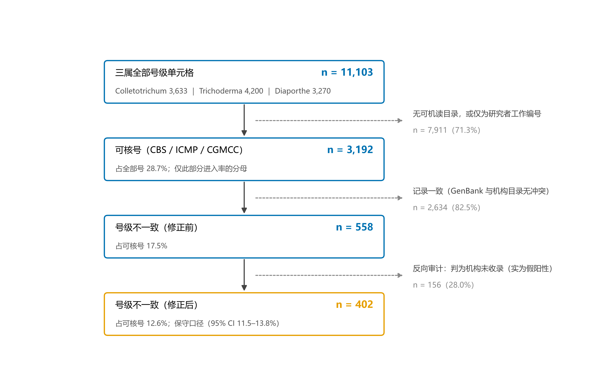
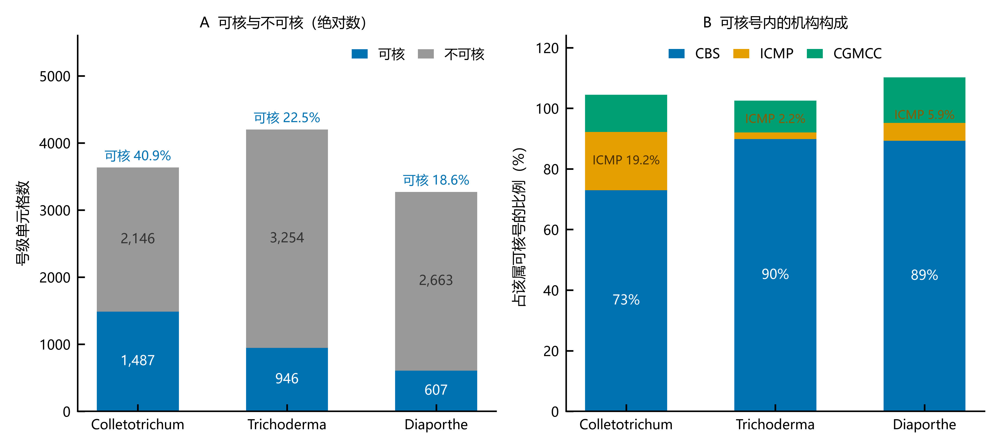
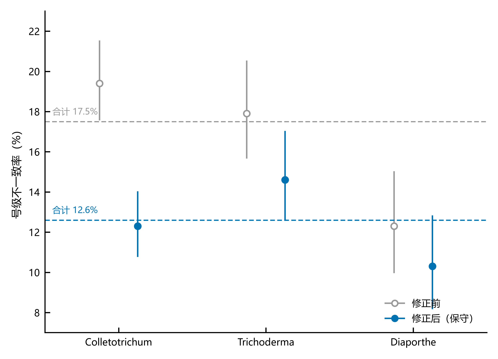

# 属级元数据审计：三个真菌属的保藏号、模式地位与名称一致性

**A genus-level metadata audit of three fungal genera: culture numbers, type status and name consistency**

（草稿 v1.3 ｜ 2026-10-23）

---

## 摘要

**背景**　公共数据库中的菌株保藏号、模式地位与名称是分类学与流行病学研究的共同基础，但其准确性长期缺乏系统性检验。同一批菌株在 GenBank（作者申报）、NCBI Taxonomy、MycoBank 与各保藏中心目录（人工维护）之间可能给出彼此矛盾的记录，此类标识混乱已在生物多样性信息学的标本三元组层面被量化<sup>[1]</sup>，模式衍生序列的策展也已在原核与真菌层面系统推进<sup>[2,3]</sup>；但在真菌命名学语境下，尚无「属级 × 跨库 × 带分母口径」的量化，种级分歧的方向与机制亦未被检验。

**方法**　以 Colletotrichum、Trichoderma、Diaporthe 三个属为对象，取 NCBI 分类库中全部规范双名（408、445、507 种，合计 1,360 种），对每个出现的保藏号做四层核验：号层（机构目录是否存在、登记名与模式地位是否相符）、名字层（NCBI 分类名、MycoBank 接受名、机构登记名、GenBank 记录名四方交叉）、序列层（同一保藏号在 GenBank 中被标注成几个不同种）、分类层（同一号被多个种登记为正模）；另设反向审计（对判为"号不存在"者回查 GenBank 是否另有引用）。对 NCBI 与 MycoBank 相互矛盾者按证据强度分级，并对同名异物按命名人与模式材料逐条对号。

**结果**　三属合计 11,103 个号级单元格，其中 3,192 个（28.7%）属 CBS、ICMP、CGMCC 三个有公开机读目录者，可核率因机构覆盖不同而在属间相差约两倍（42.7%–20.5%）。经反向审计修正后，可核号中的号级不一致率为 **12.6%**（另有 974 条号级不一致落在无可机读目录的号上，不进入该率的分母）。三属共 **153** 条 NCBI–MycoBank 种级分歧，**已全部逐条核查**，其中 123 条可定性，其中 **114 条支持 MycoBank**、8 条提示 MycoBank 过度合并、1 条两库均无误。需注意这批分歧的 **76.5% 来自 Diaporthe**（117/153），因此「支持 MycoBank」这一方向不能直接外推到另两属。此外另有 **41 条**（不计入上述 153 条）经核查为拼写或词尾变体，不构成分歧——即「在 MycoBank 中指向别的名」共 **194** 条（153 ＋ 41）。以 30 条分层子样本按原始发表复核，12 条需修正、其中 9 条为机构目录记名与原始发表不符，说明“以机构目录为真值”这一隐含假设不成立。

**结论**　没有任何单一来源可以充当真值。**号级**上，1,532 条不一致中 **668 条（43.6%）的「号」根本不是机构号**、仅 485 条涉及名称冲突，另有 147 条「一株多名」（同一保藏号被标成两个种）——问题主体是「号不可核查」而非「名字写错」。机构目录与 GenBank 也会互相矛盾，而「目录查不到」多数是机构未收录、并非号不存在——单以目录为真值会把不一致率报成修正值的 1.39 倍。**种级**上，两库分歧并非「一正一误」，而是**在不同策展对象上分工不同**：NCBI 主动策展模式地位与菌株—序列关联，但对命名学异名合并保守；MycoBank 主动跟进文献做异名合并，但存在过度合并风险。因此按学名跨库匹配必须辅以命名人与模式材料核对，否则同名异物会造成静默错误。

**关键词**　元数据审计；保藏号；模式材料；NCBI Taxonomy；MycoBank；同名异物；有性型属名（teleomorph）

---

## Abstract

**Background** Culture collection numbers, type status and names underpin taxonomic and epidemiological research, yet their accuracy has rarely been tested systematically. The same strain may carry contradictory records in GenBank, NCBI Taxonomy, MycoBank and institutional catalogues. Identifier irregularity of this kind has been quantified for Darwin Core triplets [1], and curation of type-derived sequences is well advanced for prokaryotes and Fungi [2,3]; however, no genus-scale cross-database quantification with an explicit denominator has been reported for fungal nomenclature, and the direction and mechanism of the species-level conflicts remain untested.

**Methods** We audited all accepted binomials of three fungal genera in NCBI Taxonomy (Colletotrichum 408, Trichoderma 445, Diaporthe 507; 1,360 species) with a four-tier scheme—number level, name level (four-way cross-check), sequence level (one number annotated under two species), catalogue level (one number registered as type of several species)—plus a reverse audit (re-querying GenBank for numbers judged absent). NCBI–MycoBank species-level conflicts were graded by evidence strength and, for homonyms, resolved by author citation and type material.

**Results** Among 11,103 number-level cells, 3,192 (28.7%) belong to collections with machine-readable catalogues; verifiability differed two-fold among genera (42.7%–20.5%), driven by collection coverage rather than record quality. After the reverse audit, the number-level discrepancy rate among verifiable numbers was 12.6%; a further 974 discrepancies fell on numbers without any machine-readable catalogue and therefore enter neither numerator nor denominator. Of the 153 NCBI–MycoBank species-level conflicts, all were individually examined; 123 could be resolved, 114 in favour of MycoBank, 8 suggesting over-merging by MycoBank, and one showing no conflict; because 76.5% of these conflicts (117/153) come from Diaporthe, this direction should not be extrapolated to the other two genera. A further 41 names, not counted among the 153, proved to be spelling or gender-ending variants (194 name-level mismatches = 153 conflicts + 41 variants). A stratified subsample of 30 findings checked against the protologue required correction in 12 cases (9 of which were catalogue names conflicting with the original publication), showing that the "catalogue as ground truth" assumption does not hold.

**Conclusions** No single source can serve as ground truth. At the number level, 668 of 1,532 discrepancies (43.6%) involve numbers that are not institutional accessions at all, and only 485 involve name conflicts; a further 147 show one accession assigned to two different species. Institutional catalogues and GenBank also contradict each other, and "absent from the catalogue" usually means the collection did not register the number rather than that the number is fictitious—treating the catalogue as ground truth inflates the rate 1.39-fold. At the species level, the two databases differ not in correctness but in what is curated: NCBI actively curates type status and strain–sequence links while remaining conservative about nomenclatural synonymy, whereas MycoBank follows the literature and risks over-merging. Name-based cross-database matching must be accompanied by author and type-material verification.

**Keywords** metadata audit; culture collection numbers; type material; NCBI Taxonomy; MycoBank; homonym; teleomorph

---

## 1 引言

分类学研究与植物病理诊断都建立在少数几个"硬标识"上：菌株从哪来（保藏号）、凭什么定名（模式材料）、叫什么（学名）。这三项一旦出错，下游后果是具体的——流行病学研究会把不同菌株当成同一株，检疫鉴定会依据错误的名字下结论，而系统发育研究可能把一个被错误标注的序列当成新的种。

然而，这三项信息分布在**性质不同**的数据库中：

- **GenBank** 的记录是**作者申报**的，与论文同源，但从未被独立核对；
- **NCBI Taxonomy** 由策展人维护，但其策展是**分工的**：对模式地位与菌株—序列关联主动策展，对名称的**合并则非常谨慎**——一个 taxon 一旦建立，通常只有在有人主动提交合并请求时才会被并入他名；
- **MycoBank** 同样由策展人维护，但**主动跟进分类学文献**，新发表的异名处理往往较快反映；
- **各保藏中心目录**（CBS、ICMP、CGMCC 等）才是菌株实体的登记方，但公开程度与可机读性差别极大。

四者各说一套时，**没有默认的裁决者**。

### 1.1 相关工作：三条各自成熟、但彼此未对接的线

**第一条线：保藏号本身就不是可靠的主键。** 生物多样性信息学界用"三元组"（Darwin Core Triplet，即机构代码 + 收藏代码 + 目录号的拼接）作为标本记录与序列记录之间的联系键。Guralnick 等<sup>[1]</sup>（Table 2）量化过这一做法的实际效果，结论是三元组在 GenBank 与 BOLD 中「格式合规者少得惊人」。以他们的 GenBank 样本为例：仅语法有问题的 1,984 条，仅缺信息的 93,947 条，**语法与语义同时有问题的 186,128 条**。因此，未经策展的三元组并不足以承担跨库关联的角色。本文所审的"保藏号"，本质上就是真菌材料上的三元组；本文 2.4 反向审计中"必须写成 `CBS:126514` 而不能写成 `CBS 126514`"这一条，正是该问题在检索层面的直接后果。

**第二条线：模式材料一侧的策展已推进很多，但与"名字对不对"分开走。** 原核方面，NCBI 用模式菌株基因组的平均核苷酸一致性（ANI，即两基因组间的平均相似度，用于判断是否同种）做质控。目前已策展 18,281 个模式菌株组装体，据此核实了 110 万以上 GenBank 基因组的分类，并使 1,800 个以上已有基因组被重新归种<sup>[2]</sup>。真菌方面，截至 2023 年 3 月 6 日，已有 21,607 个物种具备模式衍生序列，主要来自培养物、多为 ITS<sup>[3]</sup>。`/type_material` 字段**并非作者提交**，而是经 NCBI 策展人核实文献后才自动写入<sup>[3]</sup>。这一点直接决定本文把该字段用作「模式地位」证据时的分量。与之配套的，是 2023 年 3 月 INSDC 对标本元数据的提交要求收紧，以及自 2019 年起真菌新模式指定必须登记并引用登记号<sup>[3]</sup>。

**第三条线：在真菌里，"名字"比在别处更复杂。** 2011 年"一菌一名"改革（One Fungus = One Name）之后，有性世代属名并入无性世代属名<sup>[4,5]</sup>，同一种在不同库中可能分别以两个属名出现。这种混乱的后果可以实验证实。Réblová 等<sup>[6]</sup> 复核了 7 株都以 *Pleurophragmium parvisporum* 之名（含同义登记）保藏的菌株，发现它们分属 **3 个纲、4 个不同的目或科**，只有 1 株符合该种概念——**材料归错名，错误可以一直错到纲一级**。就本文涉及的 *Colletotrichum* 而言，RefSeq Targeted Loci 项目已为 238 个种更新了 GenBank 分类、为 226 个种提供策展 ITS。它还核实了该属标注记录中约 97% 确实来自 *Colletotrichum*<sup>[7]</sup>，为本文提供了一个可用的外部参照。

**本文相对 Guralnick 等的三处推进。** 上述三条线各自成熟，但**在真菌命名学语境下，尚无"属级 × 跨库（分类库 / 名称登记库 / 机构目录）× 显式分母"的量化**，种级分歧的**方向与机制**也未被检验。本文沿用 Guralnick 等对标识符可靠性的诊断框架<sup>[1]</sup>，但在三处推进。① 引入**模式地位与命名学**维度（异名、同名异物、有性型属名）——这是真菌材料特有的问题，动物标本体系中并无对应物。② 提出**可核率与分母口径**，处理「多数记录根本无从核对」这一他们未面对的情形（本文占 71.3%）。③ 比较**两个名称登记库**之间的分歧方向与机制，并加入**反向审计**，以纠正「目录查无即号不存在」的系统性误判。此外，本文另设 30 条分层验证子样本，以原始发表为准复核自身判定（见 2.4 与 3.1），直接回应「凭什么认为机构目录是对的」——结果显示机构目录本身也会错。

本文以三个真菌属为对象回答三个问题：

1. 在属级尺度上，保藏号与名称记录之间号级不一致的频率是多少？**分母应当怎么取？**
2. 当两个维护型数据库（NCBI Taxonomy 与 MycoBank）给出相反答案时，**谁更可能对？**
3. 按学名做跨库匹配，会在哪些地方**静默出错**？

选择 Colletotrichum、Trichoderma、Diaporthe 的依据是：三者在 NCBI 分类库中有足够的种级记录（分别 2,277、2,574、1,600 个种级 taxon），过滤为规范双名后规模可比（408、445、507 种），且分属不同生态类群——植物病原（Colletotrichum）、生防与土壤真菌（Trichoderma）、内生与致病兼性（Diaporthe）。这样属间差异可以被观察，而不只是单属的偶然状况。其中 Diaporthe 近二十年大量拆种，且被证明为并系属（paraphyletic，即该属并不包含其共同祖先的全部后代）<sup>[12]</sup>，理论上正是种级分歧最可能集中的地方——这一点在结果中得到验证（见 3.2）。

---

## 2 材料与方法

本节回答一个问题：面对三属 1,360 个种、11,103 个号，「核对」这件事具体怎么做、凭什么信。四小节依次是：数据从哪来（2.1）、数什么与除以什么（2.2）、遇到模糊情形怎么判（2.3）、怎么检验自己的判定（2.4）。

**2.2 与 2.3 的每一条规则都按同一结构写：它防的是哪种错 → 我们怎么做 → 不这么做会怎样。** 这样写不是为了整齐，而是因为这些规则确实是被具体错误逼出来的——先踩到坑，才立下规矩；把坑写出来，读者才知道这条规则省掉了什么。

### 2.1 数据来源与物种清单

以 NCBI Taxonomy 的检索式为起点，取三属内全部种级 taxon，再过滤为规范双名（两词、种加词小写；剔除 `sp.`、`cf.`、`aff.` 及仅到属名者），得到 Colletotrichum 408、Trichoderma 445、Diaporthe 507 种，合计 1,360 种。

物种清单、命名人与模式材料取自 NCBI Taxonomy，序列与记录字段取自 NCBI Nucleotide，名字关系取自 MycoBank 本地导出（426,834 行），机构侧对照依据 CBS / ICMP / CGMCC 公开目录，分歧裁决依据 PubMed / PMC。全部查询完成于 **2026 年 10 月 10 日**；分类库与机构目录持续更新，本文的计数与结论仅对应这一天。

三属的「种级 taxon → 规范双名」转化率分别为 17.9%（408/2,277）、17.3%（445/2,574）、31.7%（507/1,600），提示各属在 NCBI 中的记录规范程度不同，因此不能用统一比例从一个属外推另一个属。全部核验由一条流水线分步执行，可用单条命令复现（见「数据与代码可用性」）。

至此对象已经确定；下一个问题是**数什么、除以什么**——这决定了全文所有比例的含义。

### 2.2 数什么、除以什么

**要点一：统计单位是「号 × 种」，不是「号」也不是「种」。**
**防的是**：号与种是多对多关系，按号数会漏掉「一株多名」，按种数会忽略一个种下有多少条记录。
**怎么做**：以「一个保藏号在一个种下的一次出现」为一个**号级单元格**，全文共 11,103 个。
**不做会怎样**：CBS 126514 若同时被登记在 *Diaporthe arecae* 与 *D. citri* 下，按号只算 1、按种也只算 1，而实际有 2 条记录要核——这类「一株多名」正是后文 147 条的来源（见 3.1）。

**要点二：分母只能是「可核号」。**
**防的是**：把「查不了」当成「没问题」。
**怎么做**：只以能在 CBS、ICMP、CGMCC 三家公开机读目录中核对的 3,192 个号为分母，并把可核率 28.7% 与率一起报告（表 1、图 1）。三家中心的身份是：**CBS**（荷兰威斯特代克真菌生物多样性研究所）、**ICMP**（新西兰国际植物标本馆的菌物保藏）、**CGMCC**（中国普通微生物菌种保藏管理中心）。
**不做会怎样**：7,911 个不可核号若算进分母，率会被稀释到没有意义；若干脆不提，读者无法判断这个率究竟覆盖了哪部分数据（取分母的完整理由见 4.1）。

**表 1**　三个总数：全部号、可核号与不可核号

| 总数 | 含义 | 数量 | 占全部 |
|---|---|---|---|
| 全部号 | 三属全部号级单元格 | 11,103 | 100% |
| 可核号 | 所在机构有公开机读目录（CBS / ICMP / CGMCC） | 3,192 | 28.7% |
| 不可核号 | 机构无可机读目录（NRRL、DAOM、HMAS、BRIP、CPC、MFLUCC 等），或为研究者工作编号 | 7,911 | 71.3% |

三个总数的关系见图 1。



**图 1**　审计流程与三个分母。从三属全部 11,103 个号级单元格出发，逐级筛选至最终的不一致数；右侧虚线引出每一步排除的数量与原因。百分比分别以「全部号」（前两级）与「可核号」（后两级）为分母。
*Figure 1.* Flow of the audit from 11,103 number-level cells to the final discrepancy count. Each exclusion and its size are shown at the side. Denominators differ by level: all numbers (steps 1–2) and verifiable numbers (steps 3–4).

由此得到全文唯一的分母口径：**号级不一致率 ＝ 号级不一致的单元格数 ÷ 3,192**。1,532 个号级不一致中有 558 个落在可核号内、974 个落在不可核号内，后者不进分母，是因为它们只能比较记录名与分类名，与「以机构目录为准」的口径不同；因此这个率只描述可核号这一子集，不能外推为三属整体。

**要点三：不做属间排名。**
**防的是**：把「置信区间重叠」当成「没有差异」，以及把不同质的分母当成可比。
**怎么做**：可核率与不一致率都只按属报告，只给区间，不排序、不给优劣。
**不做会怎样**：ICMP 在 Colletotrichum 的可核号中占 18.4%、在另两属仅 2.2% 与 5.4%（图 2B），三属的分母构成本就不同；即便某一对差异在检验上显著，它反映的也可能是机构构成不同，而不是记录质量更差。

**要点四：「号级不一致」「种级分歧」「错误」三个词不混用。**
**防的是**：把「记录间冲突」读成「数据库错误」，把「号的问题」读成「名字写错」。
**怎么做**：分别定义。「号级不一致」指同一保藏号在**名称**或**号本身**上与机构目录对不上，含两个子类：① **名称不符**（GenBank 说 X、目录说 Y）；② **号本身有问题**（研究者工作编号、申报模式而目录无记录、或目录中查不到）。1,532 条中 **1,047 条（68.3%）属第 ② 类**、485 条属第 ① 类。「种级分歧」指两库对「这个种该不该独立」意见不同，不涉及具体保藏号。「错误」则要求能判明哪一方错——本文只对 153 条分歧做了这种裁决，占全部发现的 2.6%。
**不做会怎样**：把三者混为一谈，12.6% 就会被读成「数据库错误率」，而它其实是「记录间冲突频率」。

### 2.3 遇到模糊情形怎么判

方法的核心不是「算」，而是「判」。下面七条规则，每条都对应一种实测中反复出现的误判；每条都按同一结构写：防什么、怎么做、不做会怎样。

**规则一：学名不同 ≠ 异名。**
**防的是**：把「换属」当成「物种被合并」。
**怎么做**：「学名与当前接受名不同」涵盖性质完全不同的四种关系，加上「本来就相同」这一基线，共五种（表 2）。判据是**种加词**：种加词相同即同一物种改名（换属），种加词不同才是物种被合并（真异名）。
**不做会怎样**：换属占 21.6%、真异名只占 14.1%；若把换属一并算作异名，Diaporthe 的异名数会虚增 44.8%，区系统计随之失真。

**表 2**　名字关系的五种情形（含基线行；MycoBank 全表 426,834 行）

| 关系 | 判据 | 行数 | 占比 | 是否同一物种 |
|---|---|---|---|---|
| 自己即接受名 | 两者相同 | 247,077 | 57.9% | — |
| **换属（新组合）** | 种加词相同、属名不同 | 92,314 | 21.6% | **是** |
| **并入别的种（真异名）** | 种加词不同 | 60,330 | 14.1% | **否** |
| 拼写/性别更正 | 词干相同、词尾不同 | 27,061 | 6.3% | **是** |
| 同名不同写法 | 仅标点/连字符差异 | 52 | <0.1% | **是** |

**规则二：证据有强弱，不能把「作者申报」当「已核实」。**
**防的是**：把 GenBank 记录名或机构目录当成真值。
**怎么做**：证据由强到弱分四档——**原始发表**（作者当年指定模式与编号，是真值）＞ 模式材料记录（二手转录）＞ 保藏中心目录（实体登记方，但公开程度不一）＞ GenBank 记录（作者申报，未经独立核对）。核验分四层执行：**号层**（目录中是否有该号、登记名与模式地位是否相符）、**名字层**（NCBI 分类名、MycoBank 接受名、机构登记名、GenBank 记录名四方交叉）、**序列层**（同一号是否被标成不同种）、**分类层**（同一号是否被多个种登记为正模）。
**不做会怎样**：本文多数判断比较的是后两档，两者都非真值；把它们当真理，就会把「机构没更新」与「作者写错」混为一谈。为此另设 30 条验证子样本，以原始发表为准复核（设计见 2.4，结果见 3.1）。

**规则三：同名异物——机器列候选，人指认。**
**防的是**：同一双名由不同作者各描述一次时，取错那一行，导致张冠李戴。
**怎么做**：MycoBank 快照为 **426,834 行**导出记录，**去重后 406,521 个学名**（差 20,313 为同名重复行），其中 **17,404 个学名出现多行（4.3%）**。完整导出含 `Authors` 与 `Year of effective publication`，可自动列出候选（37,718 条候选行，其中 73.7% 只有一个 Legitimate 行）；但 **NCBI Taxonomy 对这些种未登记命名人**（随机抽 20 个种查 `<Authority>`，0 个有值），故「哪一行对应这个 taxon」无法自动匹配。流程的处理是：**不选任何一行**，置空并标「待消歧」，同时输出候选行供人判断。本研究涉及 4 条（*D. biguttulata*、*D. longispora*、*D. salinicola*、*D. chinensis*）。
**不做会怎样**：若机械地「取合法那一行」，4 例中会有 2 例取错——例如 *D. biguttulata* 会被取到 2014 年的 *D. eres*，而 NCBI 指的是 2015 年由 F. Huang 等描述的另一个同名。另需注意此判断**依赖导出时点**：同名行数与接受名会随 MycoBank 更新而变化，引用时应连同快照日期给出。

**规则四：「目录查无」≠「号是假的」。**
**防的是**：把机构未收录误判成作者编造，冤枉保藏中心。
**怎么做**：对判为「号不存在」者做**反向审计**——回查 GenBank 是否有其他记录引用过它。检索式须写成 `CBS:126514`（冒号、不加引号）；写成 `CBS 126514` 会被分词为 `CBS` AND `126514`，实测返回两万余条无关记录。
**不做会怎样**：185 条「号不存在」中有 **156 条（84.3%）** 其实存在，只是机构没登记进可检索目录；不做这一步，等于公开指控这些中心漏收菌株。

**规则五：有性型属名——按词干比对。**
**防的是**：把「一菌一名」改革造成的属名变化当成物种分歧。
**怎么做**：「一菌一名」后，有性世代属名并入无性世代属名（如 *Hypocrea* → *Trichoderma*），判定时按种加词词干比对：`cerace-a` 与 `cerace-um` 是同一物种，仅因属名语法性别而词尾不同。
**不做会怎样**：Trichoderma 有 16 条会被误算成「物种被合并」，把分歧数虚增。

**规则六：拼写变体——查 `Name status`。**
**防的是**：把同一个名字的两种拼写当成两个名字。
**怎么做**：MycoBank 在 `Name status` 列标为 `Orthographic variant` 的条目即为拼写变体（如 *C. acidae* ↔ *C. acidi*、*D. multigutullata* ↔ *D. multiguttulata*），不计入种级分歧。
**不做会怎样**：25 条会被算成「分歧」，把「物种被合并」的数量从 153 虚报成 194。

**规则七：种级分歧按证据分级裁决。**
**防的是**：把「没查到修订文献」当成「两库都错」，或把「学界倾向」当成定论。
**怎么做**：按证据强度分四级（表 3）——A 级（同行评议论文正式列入异名表，可作结论）、B 级（论文论证应合并但未做命名学处理，只能说「学界倾向」）、C 级（未检索到修订文献，不可作结论）、D 级（MycoBank 的合并缺乏文献支持，标为候选）。同名异物不属这个序列，须按命名人与模式材料对号后单独定案（见 3.2 表 7）。
**不做会怎样**：21 条 C 级会被当成结论引用，而它们只是「没查到」。

**表 3**　分歧裁决的证据分级

| 级别 | 判据 | 可否作为结论引用 |
|---|---|---|
| A 决定性 | 同行评议论文**正式列入异名表** | 可以，须注明文献 |
| B 倾向性 | 论文**论证应合并**但未做正式命名学处理 | 只能说"学界倾向" |
| C 待查 | 未检索到对应修订文献 | 不可作结论 |
| D 反向候选 | MycoBank 的合并缺乏可查文献支持 | 标为候选 |

以上七条覆盖了「怎么判」；但规则本身也会错，下一小节说明怎么检验规则。

### 2.4 怎么检验自己的判定

**防的是**：把「我们的判定」当成「已核实的事实」。
**怎么做**：三件事。① **记录限制而不是静默丢弃**——单种记录数超过 1,500 条者只扫描前 1,500 条，受影响物种由程序逐一写入各属「覆盖声明」，三属合计 71 个（Colletotrichum 45、Trichoderma 19、Diaporthe 7）。② **回归测试**——以 32 例既有判定作回归集，改版后判据与人工复核 32/32 一致；但这 32 例本身由同一流程早期产出，故它只证明改版没有破坏既有判断，**不构成独立验证**。③ **独立抽样复核**——另设 30 条验证子样本，按三类判定各取 10 条，用确定性等距抽样（池内固定步长，可复现），以原始发表（protologue）为准逐条核对；三个池按单元格口径为 201 / 189 / 291 条，去重到「层 × 种 × 号」后为 185 / 146 / 244 条（3.1 所引「号不存在 185」是去重后的值，抽样则在 201 条中进行）。只采信正文出现该号的上下文，仅命中检索计数不算，无上下文者记「待核」。

**这 30 条用来回答什么、不回答什么。** 它是**质性检验**，只答两个问题：机构目录会不会错、本文判定偏严还是偏松。它**不用于估计总体率**——三层等额各取 10 条，而三层的真实池大小为 185 / 146 / 244（占 32% / 25% / 42%），等额分配会压低大层、抬高小层，**合并后的比例不能代表总体**；层内又各只有 10 条，区间宽达 10–83%。因此 3.1 只报告层内计数与方向一致性，不据此推算「总体需修正率」。

比例均给出 Wilson 95% 置信区间，组间比较用 Fisher 精确检验。

**不这么做会怎样**：若只报告「率」而不说判定本身可能错多少，读者会把 12.6% 当成一个精确值；而本文自己的复核显示，30 条里有 12 条需要修正——错的部分在 3.1 逐项交代。

## 3 结果

本节分两层。**号级**（3.1）问三件事，且是一件接一件问的：能核对的号有多少（分母）、分母之内有多少冲突（分子）、这个分子本身可不可信（自检）。**种级**（3.2）问两库对「这个种该不该独立」的分歧是一方错还是各有分工。

两层合起来支持一个结论：**没有任何单一来源可以作为真值**。

### 3.1 号级：分母有多大、冲突有多少、这个数有多可信

#### 第一步：分母有多大——能核对的号只占 28.7%，且属间不可比

三属可核率相差约两倍（42.7% ÷ 20.5% = 2.08；表 4、图 2），但原因不在记录质量：**ICMP 在 Colletotrichum 的可核号中占 286 个（18.4%），而在另两属占比很低**（2.2% 与 5.4%，见图 2B）。Colletotrichum 为植物病原菌，菌株大量存于植物病理保藏中心；Trichoderma 以生防与土壤来源为主，Diaporthe 以内生与致病兼性为主，均少存于 ICMP。更重要的是**工作编号**：Trichoderma 的「疑似非机构编号」中，G.J.S.、C.P.K. 等人名缩写占 223/396（56.3%），来自少数实验室的私人工作收藏。因此**可核率反映的是「我们恰好有哪些机构的数据」，而非物种本身的记录质量**，属间不可直接比较。



**图 2**　三属的可核率与机构构成。**A** 各属号级单元格按「可核 / 不可核」堆叠（绝对数），柱顶为可核率（42.7%、23.1%、20.5%）。**B** 仅在可核号内，按保藏机构构成（CBS / ICMP / CGMCC，%）。ICMP 在 Colletotrichum 占 18.4%，另两属仅 2.2% 与 5.4%——可核率的属间差异主要来自机构覆盖，而非记录质量。
*Figure 2.* **A**, number-level cells per genus, stacked as verifiable vs non-verifiable (absolute counts); the percentage above each bar is the verifiable fraction. **B**, within verifiable numbers only, composition by holding collection (%). ICMP accounts for 18.4% in *Colletotrichum* but only 2.2% and 5.4% in the other two genera.

**表 4**　三属总体

| 属 | 物种数 | 号级单元格 | 可核号 | 号级不一致 | 不确定 | 非错 | 种级分歧 | **合计发现** |
|---|---|---|---|---|---|---|---|---|
| Colletotrichum | 408 | 3,633 | 1,553 | 610 | 1,128 | 75 | 31 | **1,844** |
| Trichoderma | 445 | 4,200 | 970 | 624 | 1,621 | 91 | 5 | **2,341** |
| Diaporthe | 507 | 3,270 | 669 | 298 | 1,142 | 39 | 117 | **1,596** |
| **合计** | **1,360** | **11,103** | **3,192** | **1,532** | **3,891** | **205** | **153** | **5,781** |

> 四类互斥，逐属相加即为「合计发现」。各属可核率见图 2A（42.7% / 23.1% / 20.5%，合计 28.7%）。

**分母到此确定：3,192 个可核号。** 下一问在这个分母之内有多少冲突。

#### 第二步：分母之内有多少冲突——1,532 条，且多数问题不在名字而在号

5,781 条发现按性质分四类，四者互斥：

- **号级不一致 1,532 条**——同一个保藏号，GenBank 记录名与机构目录登记名不符。这是本文要量化的对象；内部以「疑似非机构编号」668 条最多，其次为「申报模式而机构无记录」194 条（号级记录数，与 3.2 中「名字层面 194 条」不是同一个量，纯属数值巧合）与「号不存在」185 条（此三类合计 1,047 条，余 485 条分散在并名冲突、基名属、别的属等次要类别）。
- **不确定 3,891 条**——号没有可机读的目录、或记录未核，**根本无从判断对错**。其中「无公开数据库」3,122 条占全部发现的 54.0%，成因即第一步的可核率限制。
- **非错 205 条**——**看着不符、其实是正常差异**：种加词换了属、同一物种在 *Hypocrea* 与 *Trichoderma* 两名下的词尾差异、拼写变体、机构只记到**种下单元**（变种、变型等亚种级名称）等。
- **种级分歧 153 条**——两库对「这个种该不该独立」意见不同，**不涉及具体保藏号**（见 3.2）。

其中「号不存在」185 条最需要单独处理：「号不存在」指「声称用于某个种、但在该机构公开目录里查不到的号」。**「目录查不到」不等于号是假的**——也可能是机构没有把它登记进可检索的目录；若一概当作不存在，就等于指认保藏中心漏收、或作者编造。因此下一问必须回到原始记录去查。

#### 第三步：把可疑的那一类回头查——84.3% 的「号不存在」其实是机构未收录

对 185 条逐条回查 GenBank：其他记录若引用过该号，说明它确实存在过（检索式须写成 `CBS:126514`，详见 2.3 规则四）。结果是 **156 条（84.3%）实为机构未收录**；20 条属基因组级大记录、未能核对原文；5 条无引用，4 条查询失败。

如 2.2 所述，1,532 个号级不一致中只有 558 个落在可核号内、进入分母，因此下列比率只描述可核号这一子集。

**表 5**　反向审计前后号级不一致率（保守与乐观两种口径）

| 属 | 可核号 | 修正前号级不一致（率） | 保守口径（仅移出已核对者） | 乐观口径（含 20 条大记录） |
|---|---|---|---|---|
| Colletotrichum | 1,553 | 302（19.4%） | 191（**12.3%**） | 180（11.6%） |
| Trichoderma | 970 | 174（17.9%） | 142（**14.6%**） | 133（13.7%） |
| Diaporthe | 669 | 82（12.3%） | 69（**10.3%**） | 69（10.3%） |
| **合计** | **3,192** | **558（17.5%）** | **402（12.6%）** | **382（12.0%）** |

本文以**保守口径 12.6%** 为主要结果：只把核对确认的 156 条计为「机构未收录」；20 条大记录仍计为「号不存在」。若它们也计为「机构未收录」，则为 12.0%。



**图 3**　三属的号级不一致率与 95% 置信区间。点为各属不一致率，竖线为 Wilson 95% 置信区间，虚线为三属合计率。灰色空心点为反向审计修正前（合计 17.5%），蓝色实心点为修正后保守口径（合计 12.6%）；分母为各属可核号数（1,553 / 970 / 669）。
*Figure 3.* Genus-level discrepancy rates with Wilson 95% confidence intervals; dashed lines are the pooled rates. Open grey symbols, before reverse auditing (pooled 17.5%); filled blue symbols, conservative post-correction values (pooled 12.6%). Denominators: 1,553 / 970 / 669 verifiable accessions.

**主结果 12.6% 的 95% 置信区间为 11.5–13.8%**（Wilson 法，一种在小样本下比正态近似更稳的比例区间算法）；修正前 17.5% 为 16.2–18.8%，乐观口径 12.0% 为 10.9–13.1%。三属两两比较（均基于修正后数据）仅 Trichoderma 与 Diaporthe 差异显著（*p* = 0.011），另两对不显著（*p* = 0.103、0.196）；但本文仍不作跨属排名，理由见 2.2。

由此得到两个派生量：**修正前的 558 条中 28.0% 是假阳性**（156/558；乐观口径 31.5%），**单以机构目录为真值会把率报成修正值的 1.39 倍**（17.5% ÷ 12.6%；乐观口径 1.46 倍）。

#### 第四步：这个数本身可不可信——两条证据，各管一件事

前一步修正的是「哪些算不一致」，但没有回答「我们的判定规则本身会不会错」。对此有两条互不替代的证据。

**其一，数据库自相矛盾——证明不一致确实存在。** 同一保藏号的 GenBank 记录被标注为两个不同种者，三属合计 147 条（Colletotrichum 72、Trichoderma 47、Diaporthe 28）。其中 137 条为两个不同双名，10 条为同一物种下的不同种下单元（变种、变型等）。这一类是**数据库自己写下的矛盾**，不依赖任何判定规则，因而是最硬的证据。例如 Diaporthe infertilis 的 CBS 230.52 在 15 条记录中被分别标注为 *D. citri* 与 *D. infertilis*。

**其二，30 条抽样复核——界定我们的判定会错到什么程度。** 先给最不利的一条：按原始发表逐条核对后，**12 条需修正**（表 6）。

**表 6**　30 条验证子样本的裁决分布

| 层 | ① 判定过强 | ② 支持判定 | ②′ 部分支持 | ③ 机构记录与原始发表不一致 | ④ 待核 | 未裁 |
|---|---|---|---|---|---|---|
| 号不存在 | 3 | 4 | 0 | 0 | 3 | 0 |
| 名称不一致 | 0 | 4 | 0 | 3 | 3 | 0 |
| 模式地位 | 0 | 2 | 1 | 6 | 0 | 1 |
| **合计** | **3** | **10** | **1** | **9** | **6** | **1** |

> 注：③ 指「机构记录与原始发表不一致」，**方向不一定是机构错**。其中模式地位层的 6 条，原始发表确实指定了 ex-type culture，只是**机构目录未公开该类型信息**——属信息公开不足，非作者虚报；名称不一致层的 3 条才是机构记名与原始发表不符（如 CPC 38800）。

如表 6，三层各 10 条中判为「需修正」的分别是 3、3、6 条（依次为：该号其实存在、机构记名与原始发表不符、机构目录未公开类型信息）；合计 23 条有明确文献结论，其中 11 条支持本文判定、12 条需修正，另 7 条无法判定。

**三层的修正方向一致**：12 条中 9 条是「错在机构而非作者」，3 条是「号其实存在」——两者都指向同一结论：本文的判定**偏严**，号级不一致率 12.6% 应视为**上限**估计。若按各层池大小加权（185 / 146 / 244），合并后约为 43%，但层内样本各仅 10 条、区间宽达 10–83%（如模式地位层 6/10 的 95% CI 为 31–83%），故**不作为总体率的点估计**（理由见 2.4）。

三点结论：**机构目录确实会错**（名称不一致层 10 条中 3 条与原始发表不符，如 CPC 38800）；**「机构无此记录」多数是信息公开不足、而非作者过度申报**（模式地位层 10 条中 6 条确为 ex-type culture，即原始发表指定的模式菌株衍生培养物）；**「号不存在」判得过强**（3 条在 PMC 全文中被引用，与第三步的反向审计一致）。

**12 条中有 9 条只改变归因**——号级不一致依然存在，只是错的一方由 GenBank 变为机构目录；另 3 条是「号其实存在」，与上文的 156 条同类。因此 12.6% 作为记录间冲突频率不受归因修正影响，但仍可能偏高——它是当前口径下的**上限**。

#### 小结与过渡

号级层面的答案到此完整：**分母 3,192（28.7%）、分子 402（12.6%）、且 12.6% 是上限而非点估计**。但这个结论只覆盖「号与名」的记录层；两个分类库对「这个种该不该独立」的判断是否也有系统性偏差，是另一层问题——下一节处理。

### 3.2 种级同理：两库不是一正一误

三属合计 **153** 条种级分歧：Diaporthe 117 条（占该属物种的 23.1%、占全部分歧的 76.5%）、Colletotrichum 31 条、Trichoderma 5 条。**全部逐条核查**，结果如表 7：

**表 7**　三属 153 条种级分歧的逐条裁决结果

| 级别 | Diaporthe | Colletotrichum | Trichoderma | 合计 | 判定依据 |
|---|---|---|---|---|---|
| A 决定性 | 94 | 13 | 4 | **111** | 同行评议论文正式列入异名表 |
| I 同名异物 | 4 | 0 | 0 | **4** | 按命名人与模式材料对号 |
| D 反向候选 | 1 | 7 | 0 | **8** | MycoBank 的合并缺乏文献支持 |
| B 倾向性 | 9 | 0 | 0 | **9** | 论文论证应合并、未做正式处理 |
| C 待查 | 9 | 11 | 1 | **21** | 未检索到对应修订文献 |
| **合计** | **117** | **31** | **5** | **153** | —— |

**表 7 中 I 级 4 条的处置**：3 条经按命名人与模式材料对号后**支持 MycoBank**，1 条**两库均无误**。因此「支持 MycoBank 114 条」＝ A 级 111 ＋ I 级 3；I 级剩下的第 4 条计入「两库均无误 1 条」。核对关系：**已定性 123 ＝ A 111 ＋ I 4 ＋ D 8**。

另有 **41 条**虽在 MycoBank 中指向别的名（与上表 153 条合计 194 条），经核对实为**名字变体**，按 2.3 的规则不计入种级分歧，故未列入本表：25 条是**拼写变体**（同一名字的两种拼写，MycoBank 标为 `Orthographic variant`），16 条是**词尾变体**——同一物种在 *Hypocrea*（阴性）与 *Trichoderma*（中性）两名下词尾不同（如 *T. latizonatum* ↔ *H. latizonata*）。

已定性的 **123 条**中，**支持 MycoBank 114 条**（A 级 111 + 同名异物中 3）、**提示 MycoBank 过度合并 8 条**、两库均无误 1 条；其余 30 条（B 9 + C 21）不作结论。**这一方向提示，两库的差异并非随机的对错，而是策展分工的系统后果**——为什么是这样，见 4.1。但需注意方向并不在三属中一致：**Diaporthe 占全部分歧的 76.5%，其 A 级又集中于同两篇修订**（Pereira & Phillips 2023/2024），而 **Colletotrichum 的 31 条里 7 条是「MycoBank 可能并错」的反向候选（22.6%）**，方向与 Diaporthe 相反。因此「支持 MycoBank」这一总结论主要由 Diaporthe 提供，不能直接外推到其他属。

**Diaporthe 的 A 级 94 条与两篇文献所述种数（52 + 53 = 105）的差额已核对清楚**：105 个名字中有 94 个出现在本研究的 507 个规范双名内，且全部构成分歧；**其余 11 个不在清单内**，原因有二。其中 **10 个在 NCBI 分类库中已无独立的物种级 taxon**——NCBI 早已并入他名，因此不构成「NCBI 保留独立 taxon」这一分歧前提。另 1 个（*D. lithocarpi*）虽有 taxid（1344039），但在 NCBI 标注为 **(nom. inval.)**（无效名），被「规范双名」过滤规则剔除。

**因此 94 与 105 的差额不是漏计，而是分母不同**：文献计的是「被并入的名字」，本研究计的是「既在我们物种清单内、又构成 NCBI–MycoBank 分歧的名字」。

## 4 讨论

### 4.1 两种策展对象上的分工

本研究最重要的发现不是"谁的错更多"，而是**两库在不同策展对象上的投入不同**。两库的分工见表 8。把它们笼统说成"一个只增不并、一个主动合并"并不准确——NCBI 在模式材料一侧是**主动策展**的，保守只出现在命名学一侧：

**表 8**　两库在不同策展对象上的分工

| 策展对象 | NCBI Taxonomy | MycoBank | 本文中的体现 |
|---|---|---|---|
| **模式地位 / 菌株—序列关联** | **主动**：`/type_material` 经策展人核实文献后自动写入；原核已策展 18,281 个模式菌株基因组，真菌 21,607 个物种有模式衍生序列<sup>[2,3]</sup> | 相对较弱，以名称与模式信息登记为主 | 号层核验可依赖该字段（2.1） |
| **命名学异名合并** | **保守**：taxon 建立后通常需有人提交合并请求 | **主动**：策展人跟进文献，2023/2024 两篇的合并已吸收 | 94 个已被文献否定的名字仍各占独立 taxid |
| **主要风险** | 滞后（物种被拆得过细） | 过度合并（新种可能被过早并入旧种） | —— |
| **本例证据** | 111 条滞后；3 条使用不合法晚出同名 | **8 个过度合并候选**（Colletotrichum 7、Diaporthe 1），均未定案 | —— |

**MycoBank 一侧的过度合并共 8 个候选**（Colletotrichum 7、Diaporthe 1），证据强度从「系统树中为独立末端」到「两篇主要修订均未收录」不等。值得注意，**问题最集中的并非近年被大量并种的 Diaporthe，而是 Colletotrichum**——与「修订越活跃、合并越激进」的直觉相反。**它们都只是候选**：文献把某个名当作独立种在用，只是间接证据，不等于该合并一定错；定案需要 MycoBank 页面所列的异名参考文献，或模式株的多基因系统发育。

这意味着 NCBI 保留独立 taxid 在分类学上「过细」，但在生物学上未必无意义。

### 4.2 给研究者与库方的建议

本节按受众分两组：前五条针对**生物学研究者**的日常动作（查名字、引菌株号、判断模式菌株、发表新种、引用异名），后两条针对**数据库与元数据提交方**。本文的多数发现在这两类读者手里用法不同，故不混列。

**（一）对生物学研究者**

1. **查到一个名字时，先在 NCBI 与 MycoBank 各查一次，再判断不一致属于哪一类。** 种加词相同（只是属名变了）→ 同一物种，正常的换属；词干相同、词尾差一两个字母 → 同一物种，拼写或属名性别差异（如 *H. latizonata* / *T. latizonatum*）；**种加词完全不同 → 才可能是两个物种**，需查文献。本文 194 条「名字不同」中有 **41 条（21.1%）属前两类**，根本不是物种问题。

2. **引用菌株号时写出完整机构代码，检索时用冒号形式。** `CBS:126514` 能精确命中；`"CBS 126514"` 会被检索系统拆成两个词，实测返回**两万余条**无关记录。论文中按「机构代码 + 空格 + 号」（CBS 126514）的规范写法，不要写成 CBS126514 或 CBS-126514——本文 71.3% 的号无法核对，主因之一就是这类非标准写法与机构目录对不上。

3. **判断「这株是不是模式菌株」，不要只看 GenBank 的 `/type_material`。** 该字段由 NCBI 策展人核实文献后写入，可靠性较高，但**机构目录可能根本不公开类型信息**。本文 30 条抽样中，**6 条「机构无此记录」实为机构未公开**——若据此判定作者虚报，会冤枉人。两者冲突时应以**原始发表**为准。

4. **发表新种后，隔一段时间回查 MycoBank。** 本文找到 **8 个「新种被并入老名」的候选**；最典型的一例是 2024 年发表的新种被并入 2013 年的老种，而两篇主要修订均未收录它。**新种发表不等于被接受**，投稿与后续引用前值得再查一次。

5. **引用异名时区分「换属」与「真异名」，写法不同。** 换属（占 MycoBank 记录的 **21.6%**）只是属名变了、物种没变，规范写法为「新属名 种加词 (旧作者) 新作者」；真异名（14.1%）才是物种被合并。若把换属当异名，会让读者误以为物种数减少——本文若如此处理，Diaporthe 的异名数将虚增 **44.8%**。

**（二）对数据库与元数据提交方**

6. **提交时把 `/strain`、`/culture_collection`、`/type_material` 三个字段写全、写规范。** 本文 **71.3% 的号无法核对**，主因不是记录错，而是所在机构没有可机读目录、或作者用了非标准写法。**「字段完整」不等于「可关联」**——即便三个字段都填了，只要写法与机构目录不一致，三元组依然对不上（30 条抽样中有 9 条属此类）。INSDC 已于 2023 年 3 月收紧标本元数据的提交要求<sup>[3]</sup>，本文结果可作为该规则适用面的补充证据。

7. **机构目录公开类型信息，收益远大于成本。** 本文「申报为模式材料而机构目录无记录」共 **194 条**，按机构高度集中：**CGMCC 侧 174、CBS 侧 20、ICMP 侧 0**。这种集中说明它是**类型信息公开程度的差异**，而非作者普遍虚报；补上这一个字段，可一次性消除这一整类「疑似错误」。

### 4.3 可核查性本身应当被报告

"无公开数据库"占全部发现的 54.0%，可核率仅 28.7%。这意味着**多数记录既不能被证实也不能被证伪**。若研究只报告"错误率"，会隐去这个更基础的限制：**该领域元数据的可核查性本身很低，且因属而异。**

同样地，反向审计显示 84.3% 的"号不存在"是假阳性。单一来源判定不仅会把号级不一致率报成修正值的 1.39 倍（保守口径），还会把"机构未收录"误报为"号是编造的"——这是对保藏中心的实质性误伤。

**由此引出一条更普遍的纪律：分母无法定义的地方，不应报告比例。** 本文按属报告号级不一致率，但不按保藏机构（CBS / ICMP / CGMCC）报告。原因不是数据不足，而是**分母无法定义**：

- 「申报为模式材料、而机构目录无此记录」共 **194 条**（Colletotrichum 86、Trichoderma 73、Diaporthe 35），按机构高度集中：**CGMCC 侧 174、CBS 侧 20、ICMP 侧 0**。这一检查项的分母应为「**该机构所有被申报为模式材料的号**」。现有数据只在**出错时**才打标记，因此这个分母并不存在；若改用「该机构的可核号数」作分母，等于把**类型信息的公开程度**误读为**策展质量**。
- 同理，「号不存在」的合适分母是「该机构所有被引用的号」，而各机构被引用的总量与其公开程度高度相关，本身无法跨机构对齐。
- **各机构承受的检查项并不相同**：目录字段的丰富程度不同，能被施加的检查就不同；在不同检查项集合上算出的比例不具备可比性。同一机构内部的跨属差异亦可大于机构之间的差异。

因此，凡分母无法定义的层面，本文一律不报比例。这与上文分母口径的设定是同一条纪律——**宁可报告「不可核」，也不制造一个看起来精确的率**。机构侧的原始计数可按机构字段核对，但本文不将其换算为率。

同一逻辑也适用于号级不一致率的属间比较（见 2.3）。

### 4.4 局限性

本节按「本研究**不能**回答什么」来写，而不是按技术细节罗列。

1. **不能外推到其他属。** 只审计了 Colletotrichum、Trichoderma、Diaporthe 三个属。三者可核率相差约两倍（42.7% ÷ 20.5% = 2.08），而这一差异来自机构覆盖而非属本身的记录质量，因此本文的率不能套到别的属上。

2. **71.3% 的号无法核对。** 只覆盖 CBS / ICMP / CGMCC 三家有公开机读目录的保藏中心。NRRL、DAOM、CPC、MFLUCC 等机构的号，只能比对 GenBank 记录名与 NCBI 分类名，**不能按「机构目录为准」判定**——这些号既没有进分子，也没有进分母。

3. **判定的是「记录冲突」，不是「物种真相」。** 机构目录与 GenBank 都不是真值。只有 153 条种级分歧做过逐条文献核查（其中 123 条可定性）；号级不一致**没有**逐条查原始发表，30 条抽样只能给方向（12 条需修正），不足以给逐条结论。

4. **没有使用序列证据。** 本文**不判断「这株菌是否真的属于这个种」**。公共库中同种内 ITS 差异可达 9.42%（*D. arecae* 6 条记录两两比较），单个位点的距离不足以支撑种级判定，须用多基因、模式株与 GCPSR（genealogical concordance phylogenetic species recognition，基因谱系一致性系统发育物种识别）流程。

5. **时间点固定。** 全部查询完成于 2026 年 10 月 10 日。两库与机构目录持续更新，重跑会得到不同数字；引用本文数字时应连同日期一起引用。

6. **技术性截断（对结论影响有限，列此备查）。** 单种记录数超过 1,500 条者只扫描前 1,500 条，受影响物种 71 个（见各属「覆盖声明」）；20 条基因组级大记录未能逐条核对，占「号不存在」的 10.8%，保守计为号级不一致（若改计为「机构未收录」，号级不一致率降至 12.0%）；本地 MycoBank 导出无作者列，12,413 个同名异物只能人工消歧，无法批量自动化。

---

## 5 结论

1. **不一致的主要形态是「号本身不可核查」，不是「名字写错」。** 1,532 条号级不一致中，**668 条（43.6%）的「号」根本不是机构号**、而是研究者工作编号；194 条（12.7%）申报为模式材料而机构目录无记录；185 条（12.1%）在机构目录中查不到；**仅 485 条（31.7%）涉及名称冲突**。在可核号内另有 **147 条「一株多名」**——同一保藏号在 GenBank 被标注为两个不同种（137 条为两个不同双名、10 条为种下单元），占可核号内不一致的 26.3%。**因此问题的主体不是「名字打错」，而是「用来指认菌株的那个号本身不可核查」。**

2. **分类学含义：两库不是「谁对」，而是各自在做不同的事。** NCBI 主动策展模式地位与菌株—序列关联，但对命名学异名合并保守；MycoBank 主动跟进文献做异名合并，但存在过度合并风险。

   **因此「以哪个库为准」没有统一答案，取决于你要问什么**——问「这株是不是模式菌株」，看 NCBI 的 `/type_material`；问「这个名现在该叫什么」，看 MycoBank 的接受名。把两者当成同一个问题的两个答案，是多数混乱的来源。

3. **后果之一：物种数与异名数会被系统性改变。** 把换属（占 MycoBank 名字关系的 21.6%）当异名，Diaporthe 的异名数会虚增 **44.8%**；把 41 条名字变体当成分歧，会把「物种被合并」的数量从 153 虚报成 194（**高估 26.8%**）。两种误读都会直接改变区系或多样性统计的结果。

4. **后果之二：按学名匹配会静默出错。** 学名层面「在 MycoBank 中指向别的名」共 194 条（＝153 条种级分歧 ＋ 41 条变体），其中 **41 条（21.1%）根本不是物种问题**（25 条拼写变体、16 条词尾变体）；MycoBank 中 4.3% 的学名对应多行记录、其中 3.1% 的接受名互相矛盾（同名异物）。这四类错误都不报错、名字看着也像，是本领域最需要显式规则的地方。

5. **测量纪律与边界。** 仅 **28.7%** 的号可核，可核号内不一致率 **12.6%**；以单一目录为真值会把率报高 **1.39 倍**（17.5% vs 12.6%），并把占「号不存在」**84.3%** 的 156 个真实号（156/185）冤枉成编造——被误伤的是保藏中心，被高估的是率本身。因此任何「错误率」都必须与可核率、分母同时报告，且读作**记录间冲突频率**而非数据库错误率：机构目录自身也会错（30 条抽样中 12 条需修正，其中 9 条为机构记名与原始发表不符）。具体建议见 4.2。

## 数据与代码可用性

代码与数据公开于 GitHub（**https://github.com/xiangccookie/typeaudit**，MIT 许可），并以 Zenodo 永久归档：

> **版本 DOI：10.5281/zenodo.23595583**（v1.2.0，commit `c288199`）
> 概念 DOI（始终指向最新版）：10.5281/zenodo.23574863

引用时请用**版本 DOI**——期刊要求「永久可引用」，而仓库可改名或删除，DOI 不会。

> ⚠️ **版本与数字的对应关系（核对前必读）**
> 本文全部数字对应 **v1.2.0（10.5281/zenodo.23595583）**，含三张图与论文全文。
> 与较早的 v1.0.9（10.5281/zenodo.23575367）相比有**三处**实质变化，**不可直接相减**：
> ① **41 条名字变体**（25 条拼写 ＋ 16 条词尾）由「分歧」改归「非错」：非错 164→205，分歧类 194→153；
> ② **补做 Colletotrichum 与 Trichoderma 的 36 条冲突裁决**（v1.0.9 只裁决了 Diaporthe 的 127 条）：已裁决的种级分歧 127→153；
> ③ 旧类别名「**矛盾**」不再使用，本版统称「**种级分歧**」（一词一义，避免混淆）。
> 完整对照见仓库 [`CHANGELOG.md`](https://github.com/xiangccookie/typeaudit/blob/main/CHANGELOG.md)。

仓库包含：审计流程源码（`src/typeaudit/`、`tools/`）、**三属全部结果表**（`results/`，25 个文件，约 1.84 MB：三列表、覆盖声明、发现汇总、四方核验、序列轴、分类库、反向审计、分歧裁决表、30 条验证子样本；另附**种级分歧 153 条总表**与**同名异物四例对照**两份补充材料）、已知错误的回归测试集（`data/known_errors.tsv`，32 例）、三个属的规范物种清单，以及方法说明文档。

为便于不具备编程基础的读者核对，仓库内附 Windows 启动器（`类型校对台.exe`）：解压后双击即可在浏览器中直接载入 `results/` 下任一属的结果，**无需联网、无需安装 Python、无需重跑流水线**；页面顶部给出三属结论速览，左栏可切换属并逐条查看每个种、每个号的判定与证据。

复现三属结果的主命令：

```
python tools/chain_genus.py --genus <属名> --chunk 40
```

该命令依次完成：取种清单 → 按 40 种分块审计 → 合并 → 补全链（四方核验、反向审计、序列轴、分类库、汇总）。

## 参考文献

1. Guralnick R, Conlin T, Deck J, Stucky BJ, Cellinese N. The trouble with triplets in biodiversity informatics: a data-driven case against current identifier practices. *PLoS ONE*. 2014;9(12):e114069. doi:10.1371/journal.pone.0114069.
2. Kannan S, Sharma S, Ciufo S, Clark K, Turner S, Kitts PA, Schoch CL, DiCuccio M, Kimchi A. Collection and curation of prokaryotic genome assemblies from type strains at NCBI. *International Journal of Systematic and Evolutionary Microbiology*. 2023;73:005707. doi:10.1099/ijsem.0.005707.
3. Renner SS, Scherz MD, Schoch CL, Gottschling M, Vences M. Improving the gold standard in NCBI GenBank and related databases: DNA sequences from type specimens and type strains. *Systematic Biology*. 2024;73(2):486–494. doi:10.1093/sysbio/syad068.
4. Hawksworth DL. The Amsterdam Declaration on fungal nomenclature. *IMA Fungus*. 2011;2:105–112. PMID: 22679594.
5. Taylor JW. One Fungus = One Name: DNA and fungal nomenclature twenty years after PCR. *IMA Fungus*. 2011;2:113–120. PMID: 22679595.
6. Réblová M, Nekvindová J, Bauchová L, Hernández-Restrepo M. Pleurophragmium parvisporum (Ascomycota): one name, seven stories — a case highlighting the need for verification of strains from public culture collections. *IMA Fungus*. 2025;16. doi:10.3897/imafungus.16.173033. PMID: 41347007.
7. Kennedy AH, Schoch CL, Marrero G, Brover V, Robbertse B. Publicly available and validated DNA reference sequences are critical to fungal identification and global plant protection efforts: a use-case in Colletotrichum. *Plant Disease*. 2022;106(6). doi:10.1094/PDIS-09-21-2083-SR. PMID: 35538602.
8. Pereira DS, Hilário S, Gonçalves MFM, Phillips AJL. Diaporthe species on palms: molecular re-assessment and species boundaries delimitation in the D. arecae species complex. *Microorganisms*. 2023;11:2717. PMID: 38004729.
9. Pereira DS, Phillips AJL. Diaporthe species on palms — integrative taxonomic approach for species boundaries delimitation in the genus Diaporthe, with the description of D. pygmaeae sp. nov. *Studies in Mycology*. 2024;109:487–594. PMID: 39717652.
10. Hilário S, Gonçalves MFM, Alves A. Using genealogical concordance and coalescent-based species delimitation to assess species boundaries in the Diaporthe eres complex. *Journal of Fungi*. 2021;7:507. PMID: 34202282.
11. Hilário S, Santos L, Alves A. Diaporthe amygdali, a species complex or a complex species? *Fungal Biology*. 2021;125:505–518. PMID: 34140147.
12. Gao Y, Liu F, Duan W, Crous PW, Cai L. Diaporthe is paraphyletic. *IMA Fungus*. 2017;8:153–187. PMID: 28824846.

*（补注：4、5 两篇为 2011 年墨尔本国际植物学大会后"一菌一名"改革的纲领性文献；如正文需要直接引《墨尔本法规》条文，应另引 McNeill 等 2012 年出版的 *International Code of Nomenclature for algae, fungi, and plants (Melbourne Code)* 纸质/在线版本，该文献不在 PubMed 中。）*

## 图表清单

**图（已成稿，600 dpi，另附 PDF 矢量版）**

| 编号 | 内容 | 文件 | 尺寸 | 数据来源 |
|---|---|---|---|---|
| 图 1 | 审计流程与三个分母（流程框图） | `Fig1_audit_flow` | 17.4 × 11.4 cm | 2.2、3.1 |
| 图 2 | 三属可核率与机构构成（两面板） | `Fig2_verifiability_composition` | 17.3 × 7.7 cm | 三列表机构构成 |
| 图 3 | 三属号级不一致率与 95% CI（点 + 误差线） | `Fig3_rate_CI` | 12.0 × 8.6 cm | 表 5、3.1 |

图件格式：PNG（预览）/ PDF（矢量投稿）/ TIFF（600 dpi、RGB、LZW 压缩）；字体已嵌入，无 Type 3。
存放目录：`07_图数据/figures/`。

**表（正文已编为表 1–8）**：表 1 三个总数｜表 2 名字关系五种情形｜表 3 证据分级｜表 4 三属总体｜表 5 反向审计前后｜表 6 验证子样本裁决｜表 7 三属种级分歧裁决｜表 8 两库分工；**同名异物四例对照**见补充材料。
